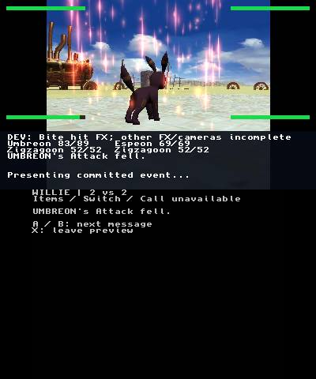
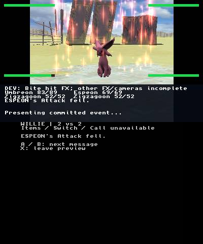

# Physical RED Attack-down checkpoint — 2026-10-24

The normal application at source `5519c82018fc58d3b8e8e9a50c1fa34e5ad388e9`
(tree `a7263591142305d48922a9e080db6f533743427a`) displayed green Defense-down
on Umbreon and Espeon, the Growl A actor effect, then **red/pink tint and vertical
luminous streaks on both Umbreon and Espeon**, each with its Attack-fell caption.
The subsequent frames show normal black/yellow Umbreon and purple Espeon colors.
The same boot reached preview WIN, field return, reentry/cancel, renderer recovery,
Homebrew Launcher, HOME and FTPD. This is evidence for the reached physical route.

## Selected actual screens

All 19 selected samples have `fresh=true`. Pixels were copied unchanged from the
closed recorder's numbered PNG samples. [manifest.json](manifest.json) retains
source UTC, top/bottom counters, ages, byte counts and SHA-256 hashes.

| Screen | Source frame | UTC on 2026-10-24 | Top / bottom counters |
|---|---:|---|---|
| [umbreon-green-defense.png](umbreon-green-defense.png) | 4150 | 22:13:04.821752 | 7059 / 7164 |
| [umbreon-before-red.png](umbreon-before-red.png) | 4160 | 22:13:05.835532 | 7077 / 7181 |
| [espeon-green-defense.png](espeon-green-defense.png) | 4170 | 22:13:06.819485 | 7094 / 7199 |
| [espeon-before-red.png](espeon-before-red.png) | 4180 | 22:13:07.836841 | 7112 / 7217 |
| [growl-a-glow.png](growl-a-glow.png) | 4220 | 22:13:11.826676 | 7182 / 7287 |
| [growl-a-after.png](growl-a-after.png) | 4230 | 22:13:12.827104 | 7199 / 7304 |
| [umbreon-red-attack.png](umbreon-red-attack.png) | 4240 | 22:13:13.822400 | 7217 / 7321 |
| [umbreon-color-return.png](umbreon-color-return.png) | 4250 | 22:13:14.821384 | 7234 / 7339 |
| [espeon-red-attack.png](espeon-red-attack.png) | 4260 | 22:13:15.821332 | 7252 / 7356 |
| [espeon-color-return.png](espeon-color-return.png) | 4270 | 22:13:16.821482 | 7269 / 7374 |
| [preview-win.png](preview-win.png) | 6400 | 22:17:08.463746 | 10896 / 11002 |
| [field-return.png](field-return.png) | 6890 | 22:18:37.665652 | 11741 / 11878 |
| [reentry-recovery.png](reentry-recovery.png) | 7060 | 22:18:59.279148 | 12140 / 12277 |
| [reentry-discard.png](reentry-discard.png) | 7500 | 22:19:43.274211 | 12946 / 13084 |
| [field-after-cancel.png](field-after-cancel.png) | 7560 | 22:19:49.279478 | 13054 / 13193 |
| [exit-recovery.png](exit-recovery.png) | 7710 | 22:20:04.275913 | 13287 / 13425 |
| [homebrew-launcher.png](homebrew-launcher.png) | 7780 | 22:20:11.284548 | 13411 / 13549 |
| [home-menu.png](home-menu.png) | 8000 | 22:20:33.279464 | 13799 / 13937 |
| [ftpd.png](ftpd.png) | 8300 | 22:21:03.274267 | 14371 / 14510 |

The viewport, letterboxing and debug HUD are retained. Before/after stills establish
visible color restoration; they do not establish a per-actor hardware idle-clock
trace. Reentry and exit recovery overlays are deliberately included. Field text
is partially clipped in some captured moments; the route is not an uninterrupted
transition or retail-presentation acceptance claim.

## Recording and excerpts

[GREEN, Growl and RED](green-growl-red-silent.mp4) is a 19-second normal-speed,
silent excerpt of encoded frames 4110–4299 (source encoded seconds 411–430).
[Finish route](finish-route-silent-5x.mp4) is a 5× silent viewing proxy of frames
6350–8339: 199 source encoded seconds, exactly 39.8 seconds / 398 frames to view. It covers
WIN, field return, reentry/discard, recovery, HBL, HOME and FTPD. Exact excerpt
frame ranges, UTC endpoints, playback factors and media hashes are in the manifest.
Both excerpts contain only video and fully decode with FFmpeg (exit 0). The
normal-speed excerpt has zero stale samples; the finish proxy retains two source
stale samples, recorded explicitly in the manifest.

The closed main recording contains 8404 encoded frames at nominal 10 fps:
840.4 encoded seconds over 1051.687 wall seconds, 20 stale samples, zero decode
errors and encoder exit 0. It independently fully decodes with FFmpeg (exit 0).
Full private recording SHA-256:
`98a7b084f3d082eb9b6576cf130762d92e32f2d8370e65f063be40fe317b51c9`.
Encoded timing does not fill wall-time capture gaps. Neither capture cadence nor
proxy playback measures game FPS. Selected stills are fresh; the recording as a
whole contains the reported stale samples.

An earlier receiver segment closed after 1099 frames / 122.390 wall seconds:
one stale sample, zero decode errors, encoder exit 0, but receiver process exit 1
from a live-image publication error (`WinError 5`). Its SHA-256 is
`4c6581384452ad0a3e7e84c6b084f5fdf988d997e2e81b5be3ccb8c1faa2fd92`.
The receiver was restarted; established NTR remoteplay was refreshed before the
preview at 22:08:56.099141 UTC (commands 0/901, no input packets, same boot, no
BootNTR reload). No input was sent while the stream was stale. These two segments
must not be described as one uninterrupted stream.

## Closed trace and readback

The [independent trace/readback audit](hardware-trace-audit.md) and
[sanitized JSON](hardware-trace-audit.json) bind the normal executable, 585311-byte
closed trace and all 30 distinct battle assets. Base readback has 11 assets;
supplemental readback has 20, with audio counted once. All final asset bytes match
the canonical dual RED/GREEN fixture. Resource packs, executable bytes, full trace
and save bytes remain private.

GREEN events 21/22 use cues 4/5. RED events 24/25 use special `0x27`, stat 1,
delta -1 and cues 7/8. Each pair completes in target order at units 118000/180000,
with emitted/peak/cosmetic draws 369/232/1772 per owner, audio FINISHED,
cleanup audio FINISHED, and color/camera restoration flags 1. Growl event 23,
cue 6, completes separately at 230000 with audio STOPPED; this is not a
natural-audio-finish claim.

Both 122832-byte preview guards are unchanged; all recorded preview turns and
exits report zero save writes and GSVM resumes. The final 393280-byte GCI is
byte-identical to the pre-deployment snapshot, SHA-256
`7e1cb3159756293bf938fd922fe45e82448d1b667f6833a48da351af3cbd0f23`;
no backup file exists. The first preview reaches WIN on turn 4, the second is
cancelled, and the final field/boot records end with result 1 and empty errors.

The public Willie CLI attempt stops safely after four steps when current state
no longer matches its authorization; it is a partial failed route, not a pass.
The private 14-action two-turn route passed in 55.984 seconds, with three neutral
release packets and zero release errors per action. UDP send counts alone do not
prove receipt; the actual captured state transitions supply the visual evidence.

Local strict and ASan/UBSan host checks and both ARM builds passed separately.
CI run40136640385 completed: host and capture checks passed. The ARM source
verification and compile step also passed; its artifact-upload step failed
because GitHub reported exhausted artifact storage quota. The local strict
normal/probe builds remain separately hash-bound. This evidence does not claim
an entirely green CI run.

## Remaining qualification gaps

The bounded original Growl attempt was watchdog-closed with **zero selected
reference images**. Its closed audit records all nine checked files unchanged,
including source/copied cards. There is no qualified original RED reference and
no original-comparison pass, pixel parity, audible qualification, all-variant
acceptance or retail-performance claim. Capture has no audio stream. Source/host
contracts and the reached physical route do not close those gaps.
