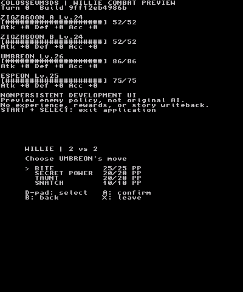

# Interactive combat-preview evidence

The native ARM diagnostic build completed a controller-driven two-turn preview
win in Azahar 2126.0 using actual prepared original tables and a fresh in-memory
WES party. Controller input exercised move selection, target selection, backing
out, two-command confirmation, event playback, the result page, and normal
application exit. No detected guest fault or application failure occurred.

**This is not the original completed Willie story battle.** It tests the same
preview core and modal text UI used by the field, through an explicit diagnostic
entry. It does not exercise the New Game/shop route, field-to-preview GPU handoff,
physical hardware, original AI, complete retail turn/RNG parity, or result/save
writeback. The preview's uniform enemy policy and independent diagnostic seed
are displayed and recorded. Native98 is not resumed.

## Exact tested identity

- Implementation: `1aafb1e448420381fc4f969d2e06d9645518e45f`.
- CI merge/build ID: `9ff12eb4986b86f4290d479f118f77e83d73400b`.
- Source tree: `4021e33170dd4d47cccad9ce4eca246ee44e5363`.
- CI run: `39871793610`, artifact `12467260407`.
- Tested file: `Colosseum3DS-battle-preview-probe.3dsx`, 376,632 bytes.
- SHA-256: `a73350937d60410ec08ad015aee8e8a0825d10aa96183c58ac5730a8300b901c`.
- The full application's ARM build also passed that run; it is a different
  executable and was not the recorded diagnostic content.

The subsequent correction `7ddb660319fae4ac3cabc3f648df5cd7523ae398`
fixes a potentially invalid error-path accessor identified by GCC13 and refreshes
the preview scene's incremental build ID. Its 11,698 focused host/private-data
checks passed normally and with ASan/UBSan and leak detection. At evidence
publication its new CI run `39872762994` was queued. **The recording is not
relabeled as the corrected executable.** This evidence commit changes no runtime
code. Check the current PR head's CI before deploying a newly rebuilt application.

## Results and preservation

Initial HP was Umbreon 86, Espeon 75, Zigzagoon A 52, Zigzagoon B 52. Turn one
used Confusion and Bite against A, then B used Tackle; HP became 81/75/0/52.
Turn two's Confusion fainted B; final HP was 81/75/0/0. The trace records the
computed preview win and clean native exit. The emulator frontend continued to
its 2,400-frame capture budget after the guest process exited; frontend budget
completion is not itself the proof of native exit.

The four private packs retained their hashes, and the emulated GCI path was
absent before and after. Separately, the host private-data test compared all
122,832 bytes of the fresh game-state body after each turn. The user's completed
save was not installed, loaded, changed, or used to establish this result.

## Recording

`Colosseum3DS-PR7-battle-preview.mp4` is supplied as a conversation attachment,
not embedded in Git. It contains actual emulator framebuffer samples, 400x480,
30-fps playback, 1,200 frames / 40 seconds, no audio. The black tail follows
normal guest exit; playback FPS is not a New 3DS performance measurement.

- Bytes: 181,545.
- SHA-256: `6cf182d1057d8e1884dfa572be7c3a028e78226ab096210163ecc53701b3361f`.
- Screenshot PNG is a lossless palette encoding of captured frame 330; decoded
  RGB pixels were checked identical to the original capture.

The input sequence, trace and verification identities are committed alongside
this report. Original game packs, emulator binaries and saves remain private.
Use the repository's existing sandbox recorder with the diagnostic build,
`input.csv`, a separate state directory, a 2,400-frame budget and a 90-second
wall limit. Stage `newgame.c3g`, `willie.c3b`, `willie.c3i` and `willie.c3p` under
the emulated `3ds/Colosseum3DS/boot/` path; do not install a GCI.

## Next acceptance

Build the corrected PR head and verify its CI. On the physical console preserve
and hash active saves, install the matching executable and the two new optional
small packs, then open the preview with A at encounter 10. Verify command
revision/cancel, a completed preview outcome, restoration of the pending field
screen, safe exit and unchanged saved party/progression. Do not merge a preview
outcome into the saved game or describe it as original story progression.
