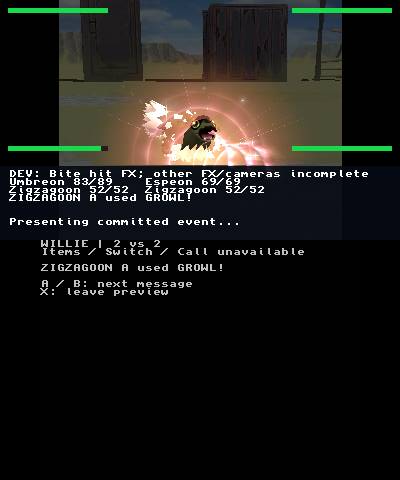

# Physical Growl checkpoint — 2026-10-23

The normal application at source `2e9ec7108d16ad1519f935f16c84d57874f52314`
(tree `3cb124f0c05a442b7f54f90e6b03536134068dbd`) displayed
**ZIGZAGOON A used GROWL!**, actor motion and a bright peach-pink curved glow
with spark particles on physical hardware. This is bounded execution evidence;
there is no verified original Growl reference or retail visual-parity verdict.
The earlier orange original Tackle capture is not Growl evidence.

## Actual selected screens

All numbered source samples below have `fresh=true`; [manifest.json](manifest.json)
retains their exact UTC, source frame, top/bottom counters and unmodified PNG hashes.

| Screen | UTC on 2026-10-24 | Source frame |
|---|---|---:|
| [Preceding Tail Whip B](tail-whip-b.png) | 08:36:59.865685 | 5170 |
| [Growl caption and actor before glow](growl-before.png) | 08:37:02.871975 | 5200 |
| [Growl glow and particles](growl-glow.png) | 08:37:04.866752 | 5220 |
| [Growl actor after glow](growl-after.png) | 08:37:05.865135 | 5230 |
| [Preview WIN](preview-win.png) | see manifest | 7000 |
| [Field return](field-return.png) | see manifest | 7150 |
| [Reentry renderer recovery](reentry-recovery.png) | see manifest | 7350 |
| [Reentry discard prompt](reentry-discard.png) | see manifest | 7600 |
| [Exit renderer recovery](exit-recovery.png) | see manifest | 7800 |
| [Homebrew Launcher](homebrew-launcher.png) | see manifest | 7850 |
| [Final FTPD](ftpd.png) | see manifest | 8150 |

The route reached WIN, returned to the pending encounter, reentered and discarded
the nonpersistent preview, then reached Homebrew Launcher and FTPD. Renderer
recovery overlays occurred during reentry and exit and are retained above;
this is not a claim that every transition was uninterrupted.

## Silent viewing excerpts

[Growl excerpt](growl-native-silent.mp4) is seven encoded seconds at normal speed.
[Finish route](finish-route-silent-5x.mp4) is a 5× viewing proxy of 119 encoded
seconds, including the recovery overlays. Both are derived from the actual closed
recording, have no audio stream, and fully decode with FFmpeg (exit 0).

The full private recording contains 8,369 encoded frames at nominal 10 fps,
839.594 wall seconds, one stale sample and zero decoder errors; its SHA-256 is
`d5a83ac8b06b1f7300ff2bbc77a60e1476fda60f541b01ab71eaf2871b7dda74`.
Encoded time and wall UTC differ because recording time gaps are retained in
metadata rather than encoded as extra frames. The proxies do not measure game
frame rate. PNGs retain the actual captured screen pixels.

## Binary, assets and audit scope

The installed/read-back normal executable is 572,800 bytes, SHA-256
`389cc6fedc4aca83c5918af147ca77d910c556ac8306045fdca947d485238a7f`.
The separate 538,732-byte probe has SHA-256
`a13837ee56ae93acabfb7ca082ca06a1e25aff77361c1a18f06b9bd7c62c9d17`;
it is not the normal executable used for this checkpoint. The manifest records
the pinned devkitARM toolchain, full release identities and postrun readback.
All 14 entries in the effect readback (including Growl descriptor/model/bank/camera
and nine-cue audio) are marked verified. No source assets, saves, executable or
configuration credentials are published here.

The [independent trace audit](hardware-trace-audit.md) records Growl cue 4
STOPPED at units 230000, family cancellation, 26 emitted/25 peak particles and
200 cosmetic draws. A sampled live voice (sound 528) precedes explicit stop at
sample 50373; this is not naturally FINISHED audio. The owner half-rate
continuation is a completion trace assertion, not per-actor hardware clock proof.
Two 122832-byte guards are unchanged, save writes/GSVM resumes are zero, and
final field/boot termination records are clean. All 24 distinct battle asset
hashes are in the sanitized [audit JSON](hardware-trace-audit.json).
Screenshots alone do not prove AppSRT matrix identity or original release-tail parity. The source contract remains in
[Native Growl](../../native-wzx-growl.md). The generic defender stat-down
presentation remains absent. The dry PCM key-off adaptation does not qualify
original release-tail timing, and this silent capture cannot qualify audible
mixing. Other unsupported moves and retail performance remain unqualified.

Integration owner reports successful CI run **40078179049** for same-code commit
`99d6`; the `2e9` run was cancelled/superseded and is not labeled successful.
Exact source build and hardware execution identities above remain `2e9`.
