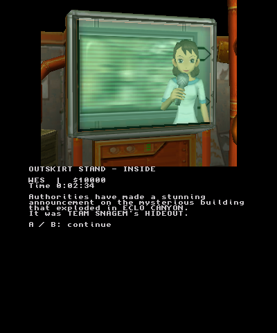
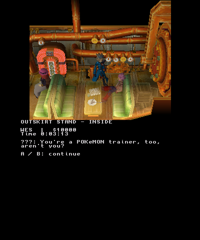
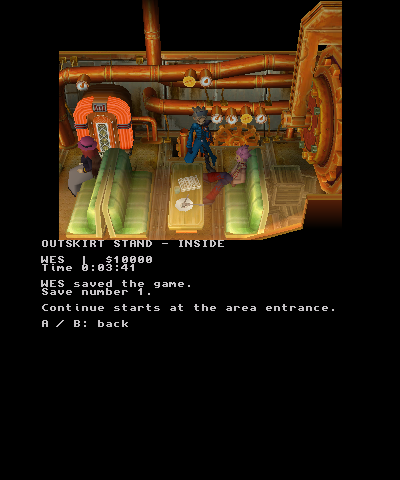
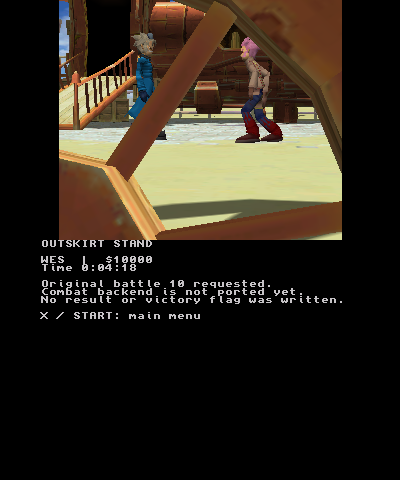

# Native first-visit acceptance — 2026-10-22

These are actual rendered frames and traces from the full native ARM `.3dsx`
running in Azahar, controlled through the libretro input interface. The fresh
run started without a primary or backup game save. The second run was a new
emulator process using the save created by the first. The uploaded completed
card stayed unchanged and was never installed in this test SD.

The tested executable is 381,732 bytes, build ID `story-review`, SHA-256
`fe5567d2d60835044d08ae4e335d3d47e95b20cad60914ae501fedadb9f36a63`.
[tested-source.json](tested-source.json) records the exact compiled source and
build inputs; [assets.json](assets.json) records the complete required private
asset set and preparation commands. No game packs, discs, executable, emulator
core or GCI bytes are committed here.

## Observed route

| Gate | Result |
| --- | --- |
| New Game → WES with an empty save folder | Passed |
| Original hideout movie and bike arrival | Passed; movie timeline 1,926 frames, 1,795 displayed and 131 skipped |
| Original Folly/Trudly departure event | Passed |
| Walk through original shop entrance | Passed |
| Original animated TV report | Passed |
| Walk to Willie and finish original conversation | Passed |
| Explicit Save in shop | Passed; WES, save count 1 |
| New-process Continue of that same GCI | Passed; shop entrance restored, TV introduction not replayed |
| Walk outside and complete original challenge dialogue | Passed |
| Original encounter-10 request | Reached; combat backend is pending |
| Battle result / victory flag `03DE` | Not written |
| Native clean exit | Passed in both runs |
| Detected guest faults / application failures | 0 / 0 in both runs |

The fresh GCI is 393,280 bytes with SHA-256
`edaa632237050912a82d679a12cebff98b0b36bd92b876dd6bfdaa20beb53799`.
Continue left it byte-identical. The save file itself remains private.

## Evidence files

- `verification.json`: route assertions, executable/core/harness identities,
  save hashes and screenshot frame numbers.
- `fresh-run.json` / `continue-run.json`: native-run bounds, exact binary and
  SD input hashes, save before/after hashes and completion status.
- `fresh-trace.log` / `continue-trace.log`: actual application events and native
  memory/renderer diagnostics.
- `*-startup.csv` / `*-live-input.csv`: boot input and the exact accepted live
  controller packets, including their actual frontend frame numbers.
- `*-controller.json`: route-stage observations and controller completion.
- `recordings.json`: identities and editing provenance for the two generated
  MP4s. They are direct emulator screen captures; only trailing
  post-exit idle frames were removed with stream copy. No overlays or generated
  gameplay frames were added. The MP4s have no audio track.
- `tests.json` and the adjacent build/test logs: final host, 175 Python-test,
  source-verification and full strict ARM-build results. The maintained private
  first-visit test passed 15,595 checks normally and under AddressSanitizer and
  UndefinedBehaviorSanitizer. Both produced the byte-identical
  `host-story-trace.log`. Leak detection was disabled because of sandbox process
  mapping restrictions; no leak-check result is claimed. Expected negative-test
  diagnostics in the logs are not test failures.

The full raw runs had 21,000 and 10,000 frontend frames. The trimmed video
durations are about 4m33s and 1m23s after trimming idle tails. The frontend was
configured for 60 Hz and sampled every two frontend frames for 30 fps video;
these values are not measured physical New 3DS performance.

## Download availability

The source, hashes, accepted inputs, traces and screenshots were successfully
published in PR #5. A subsequent sandbox refresh removed access to the local
MP4s and the exact tested binary before their downloads could be attached.
`recordings.json` is retained as provenance, not as a working video download.
The source-only controller route can produce a new recording, and the local
agent should capture the physical acceptance through the established NTR setup.
GitHub Actions also provides an independently rebuilt native artifact for source
commit `f1cc5f36bdb6bf635d4f27108e9a56774a0f1ae6`; record its own hash rather than
assigning it the sandbox-tested executable's identity.

## Remaining acceptance

PR #4 independently demonstrated the normal title shader fix on the physical
console. This combined story build still needs the
[physical first-visit route](../../native-story-handoff.md), including
Save/Continue, HOME suspend/resume, memory use and crash diagnosis. Physical
fresh-route acceptance must precede use of the completed card for later-area
testing. Combat execution, later floors, original window rendering and external
field music/SFX remain unfinished.
