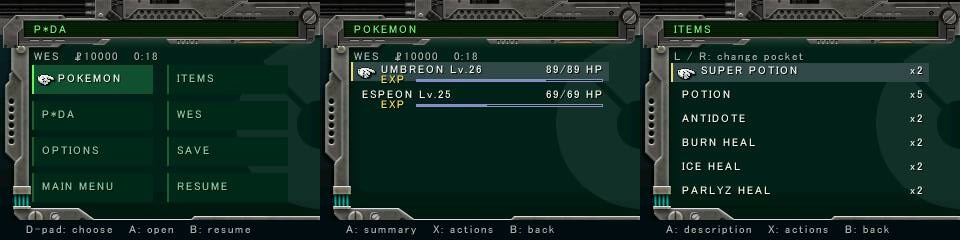

# Physical menu spacing acceptance — October 26, 2026

The normal executable (677,744 bytes, SHA-256
`42de32511bd050b7df9ca55b5b2d995c755e7aff2c20481c8368295b621424bb`)
was installed with backup, staging and readback verification. It was built
from the UI working tree before publication; its embedded base build ID is
`d57c376c6ae4`. The manifest records the compiled-source snapshot rather than
claiming a later commit was run on hardware.

P★DA, Pokémon and Items were inspected after Continue loaded the actual saved
Outskirt Stand interior. Green headings fit inside their header boxes,
cursor/highlight text clears the metal frame, and HP/item quantities remain
right-aligned. Action/target pages were also inspected on the intermediate
RGB565 candidate. No item effect or Save was committed.

The initial GUI candidate exposed a native format mismatch: libctru console
initialization selects RGB565, while the UI wrote 24-bit pixels. The native
writer now selects the actual framebuffer format and respects its two-byte
extent. A subsequent capture caught an unfinished repaint; the final build
rasterizes into a bounded CPU buffer and publishes completed images without
taking ownership of C3D frames or swaps. Host regressions exercise orientation,
alpha, exact copy bounds, cancellation and publication in both formats.

Both screens supplied fresh independently decoded NTR JPEG frames; counters
and final frame ages are in the manifest. Video reception rates are not game
performance measurements. The final executable matched its FTP readback,
START+SELECT exited cleanly, and the complete GCI remained byte-identical after
testing. The console remained in ftpd after final verification.

This accepts menu spacing/readability, not full renderer fidelity, audible
ringtone parity, HOME/sleep behavior or full-speed performance. Original game
assets, prepared packs, save files, console endpoints and raw private logs
are not published here.

The later pre-push inventory cancellation regression/fix is host-verified and
does not change these layouts. It is not represented as part of the physically
tested binary above.
