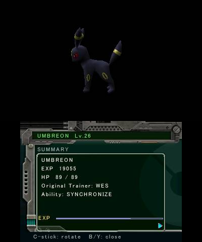
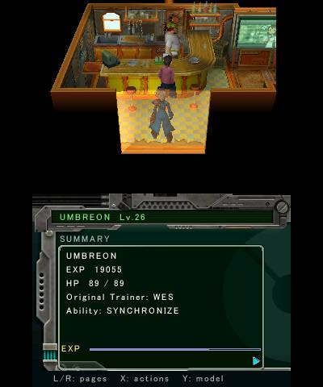
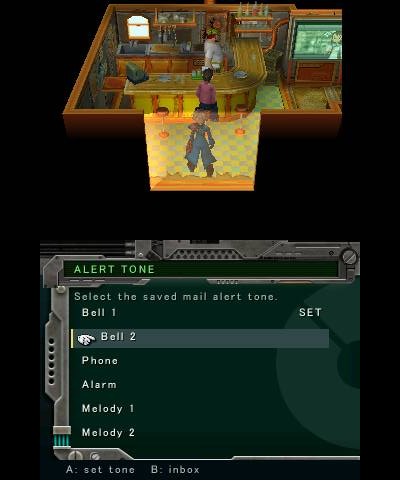
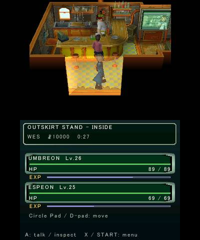

# P★DA preview and ringtone lifecycle — October 26, 2026

Normal executable (678,008 bytes, SHA-256
`2b9bde0216a2f5cf2f5478f0b9dc722eb55bc58587842e531556d46a8dc39074`)
was installed and verified through FTP readback. It contains source `8b36f58`
plus the `field_scene.c` SDK progress trace; its embedded ID is `8b36f586dbdb`.
The audit records the working-tree source hash rather than attributing a later
evidence commit to this run.

## Preview and field return

The real saved Umbreon (species 197) opens in the top-screen viewer while its
actual summary remains on the bottom. Motion/orbit was observed; C-stick input
was sent with neutral cleanup, but automatic orbit remained active, so
independent manual rotation gain is not claimed. Closing the viewer restored
the same shop scene, NPCs and TV without restarting the field VM (one
`field_begin` in the complete trace). Resuming menus then allowed observed
movement. START+SELECT exited cleanly.

## Ringtone SDK consumption

The source Bell 1 and Bell 2 cues both showed actual SDK sample advancement
while playing and then DONE with no explicit truncation. Bell 1: 7,509 samples
while playing, final 45,328. Bell 2: 7,352 samples while playing, final 58,661.
Both final positions equal their prepared waveform lengths. Changing the
highlighted audition retained Bell 1's SET marker; B cancelled to Mail.

The menus returned to field control; the player's X coordinate changed from
-5.3580 to -5.0946 after Circle Pad input. The complete GCI remained
byte-identical after the final exit and FTP readback. No save or inventory
effect was committed.

NTR TCP reconnects/freshness checks failed in a few attempts; these captures
are excluded and fresh listen-only replacements are recorded. No blind input
followed lost visibility. This accepts bounded viewer/field and SDK buffer
lifecycle, not speaker-output recording, original wet DSP/visual parity, all
species/shiny variants, HOME/sleep or full-speed performance. Private assets,
saves, endpoint configuration and raw logs remain unpublished.
