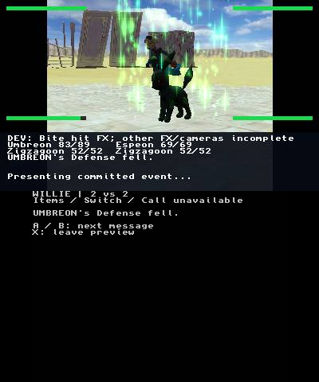
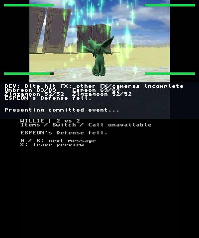

# Physical green Defense-down checkpoint — 2026-10-23

The normal application at source `5b048c8b6299f8256a3392c66a1444deeca88f5d`
(tree `1f50f8be1198acd91c5e1fbfcf1f99d70f77a0f7`) displayed Tail Whip B,
then green/cyan vertical streaks and green actor modulation on **Umbreon and
Espeon**, each with its own Defense-fell caption. The selected subsequent stills
show Umbreon returning to black/yellow and Espeon to purple. Growl A then appears
with its own actor motion and peach-pink glow. This qualifies the reached physical
route, not all variants or retail fidelity.

## Selected actual screens

All samples have `fresh=true`. Exact top/bottom counters, source UTC, byte counts
and SHA-256 hashes are retained in [manifest.json](manifest.json). PNG pixels are
copied unchanged from the numbered recorder samples.

| Actual screen | Source frame | UTC on 2026-10-24 |
|---|---:|---|
| [tail-whip-b.png](tail-whip-b.png) | 5880 | 09:32:30.028146 |
| [umbreon-green-defense.png](umbreon-green-defense.png) | 5890 | 09:32:31.023587 |
| [umbreon-color-return.png](umbreon-color-return.png) | 5900 | 09:32:32.024776 |
| [espeon-green-defense.png](espeon-green-defense.png) | 5910 | 09:32:33.023397 |
| [espeon-color-return.png](espeon-color-return.png) | 5920 | 09:32:34.021648 |
| [growl-a-before.png](growl-a-before.png) | 5940 | 09:32:36.021034 |
| [growl-a-glow.png](growl-a-glow.png) | 5960 | 09:32:38.031740 |
| [preview-win.png](preview-win.png) | 8400 | 09:36:42.027566 |
| [field-return.png](field-return.png) | 8800 | 09:37:22.020908 |
| [reentry-recovery.png](reentry-recovery.png) | 9200 | 09:38:02.023874 |
| [reentry-discard.png](reentry-discard.png) | 9800 | 09:39:02.030121 |
| [exit-recovery.png](exit-recovery.png) | 10010 | 09:39:23.026452 |
| [homebrew-launcher.png](homebrew-launcher.png) | 10100 | 09:39:32.026565 |
| [ftpd.png](ftpd.png) | 10500 | 09:40:12.022696 |

The source viewport and debug HUD are retained. The field-return sample was
selected for readable text; the route excerpt also contains less readable/clipped
field text in other moments. Renderer recovery overlays are explicitly shown
at reentry and exit, followed by actual HBL/FTPD screens. These observations do
not support a claim of uninterrupted transitions.

## Recording and viewing excerpts

[Tail Whip, both defenders and Growl](tail-defenders-growl-silent.mp4) is a
13-second encoded excerpt at normal playback speed. [Finish route](finish-route-silent-5x.mp4)
is a 45-second 5× viewing proxy covering 225 encoded seconds: WIN, field return,
reentry/cancel/discard, recovery, HBL and FTPD. Both are silent video-only media
and fully decode with FFmpeg (exit 0). They are recordings, not reconstructed views.

The original closed private recording has 10,689 encoded frames at nominal 10 fps,
1068.953 wall seconds, one stale sample, zero decode errors and encoder exit 0.
Full recording SHA-256:
`da558c640c8ae1f40721e2fc29f0e453b0c05ef36015230a97b4b2ca27abf134`.
The integration owner independently full-decoded that recording successfully.
Encoded seconds differ from source wall UTC because the encoder does not fill
all wall-time gaps. The manifest distinguishes excerpt encoded positions from
PNG capture UTC. Neither capture cadence nor proxy playback measures game FPS.

## Source, readback and qualification

The installed/read-back normal executable is 589,112 bytes, SHA-256
`0c624b53fc899b4d32ae98a2380a3da0689a9f9a1a9b48f283e148c301c7c7d9`.
The distinct probe is 555,052 bytes, SHA-256
`e822b27de9cd244312f1d641bcace066920f313f4ad5719f3b1863da58fbd377`.
The manifest records their exact roles and pinned devkitARM image. Supplemental
readback contains 17 verified effects/assets; combined with base 11 minus duplicate
audio, the independent audit covers 27 distinct battle assets. Source assets,
saves, executable bytes and console configuration are not published here.

The [independent closed trace audit](hardware-trace-audit.md) records green
event 21/target 0/cue 4 then event 22/target 1/cue 5, completing at units 118000/180000.
Each emits 369 particles with 232 peak and 1772 cosmetic draws; audio and cleanup
audio are FINISHED, with color/camera restoration flags. Growl cue 6 is separately
STOPPED at 230000 and is not a natural-finish claim. Both 122832-byte preview
guards are unchanged, writes/GSVM resumes are zero, the before/final GCI bytes
match, and final field/boot records terminate cleanly. The sanitized
[audit JSON](hardware-trace-audit.json) binds all 27 distinct battle assets.

Direct visual color return above is separate from source/host modulo-idle continuation;
there is no direct per-actor hardware clock trace. Refer to the
[green source contract](../../native-wzx-stat-down.md) for sequencing and cleanup.
The prior [Growl checkpoint](../growl-hardware-2026-10-23/README.md) is separate
`2e9` evidence and is not substituted for this exact-source run.

[CI run 40081597922](https://github.com/dougchansan/Colosseum3DS/actions/runs/40081597922)
succeeded in all three jobs for this exact `5b048c8` commit. Independent full host
strict and ASan/UBSan suites each passed 36 native executables and 309 Python tests
(258 passed, 51 skips); 3970 source hashes had no drift. These
host checks do not replace physical or original-game comparisons.

## Visual comparison and remaining gaps

The [structured visual verdict](visual-verdict.json) is **84/revise**, with
category match against the [verified original Defense-down Umbreon/Espeon
frames](../tail-whip-original-reference-2026-10-23/README.md). Both show green/cyan
vertical streaks and actor modulation, but camera, pose, effect age, cosmetic RNG
and aspect differ. A phase/camera-aligned sequence is needed before assigning
spatial/temporal parity or identifying geometry defects from these stills.
There is no verified original Growl reference and no original A/B-slot inference.

This silent evidence does not qualify audible output, original MusyX release-tail
or wet reverb, retail performance, all cameras/variants, sendouts or full story.
Red Attack-down and seven remaining move presentations are unsupported.
