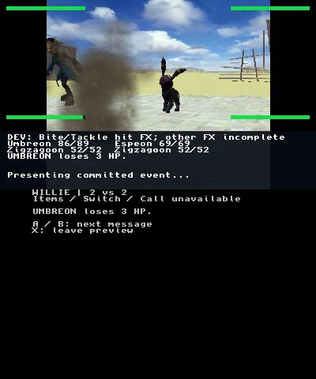
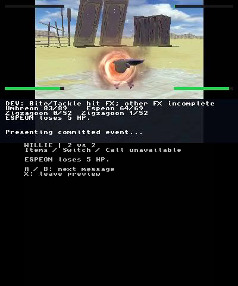
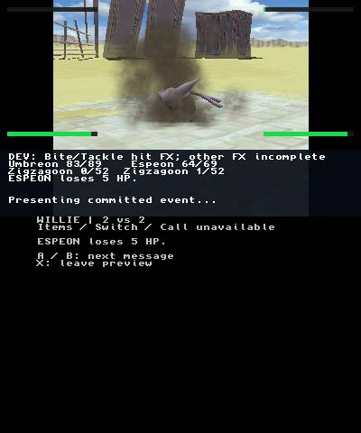
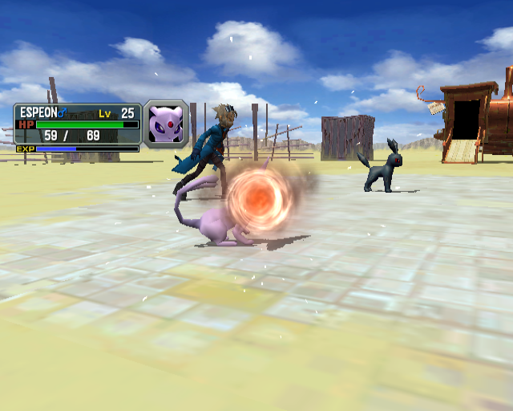

# Physical Tackle checkpoint — 2026-10-24

**Corrected bounded execution passed** at source
`c2712ebb0f6eb8de38c0ff9025011868bdaecd2f`, tree
`27c9da48c86459aac97f67815f5b0cf7bf2c236f`. Actual New 3DS screens show
both Zigzagoon attack motions and Umbreon impact effects, then a later Tackle
impact on Espeon **after the other Zigzagoon fainted**. The same native boot
reached preview WIN, field return, reentry/cancel, HBL, HOME and FTPD.

This corrects the separate failed `f6ef3a7` candidate below. It qualifies the
reached route and resource ownership; it does not establish original-game
fidelity, audible correctness or full-speed performance.

## Actual selected screens

The 19 corrected PNGs below are unchanged recorder samples, each `fresh=true`.
[manifest.json](manifest.json) retains exact UTC, top/bottom screen counters,
source frame, ages, byte counts and SHA-256. Native sample IDs are recorder
indices, distinct from original Dolphin frame IDs.

| Corrected native screen | Sample | UTC on 2026-10-24 | Top / bottom counters |
|---|---:|---|---|
| [zigzagoon-a-attack.png](zigzagoon-a-attack.png) | 3550 | 23:11:52.678526 | 6071 / 6073 |
| [umbreon-impact-a.png](umbreon-impact-a.png) | 3570 | 23:11:54.685126 | 6105 / 6108 |
| [umbreon-after-impact-a.png](umbreon-after-impact-a.png) | 3580 | 23:11:55.686765 | 6122 / 6124 |
| [zigzagoon-b-attack.png](zigzagoon-b-attack.png) | 3620 | 23:11:59.679849 | 6189 / 6193 |
| [umbreon-impact-b.png](umbreon-impact-b.png) | 3640 | 23:12:01.691476 | 6224 / 6227 |
| [zigzagoon-a-fainted.png](zigzagoon-a-fainted.png) | 4810 | 23:14:05.732110 | 8342 / 8349 |
| [zigzagoon-b-after-faint-attack.png](zigzagoon-b-after-faint-attack.png) | 4840 | 23:14:09.219359 | 8403 / 8410 |
| [espeon-impact-after-faint.png](espeon-impact-after-faint.png) | 4860 | 23:14:11.180667 | 8437 / 8445 |
| [espeon-after-impact.png](espeon-after-impact.png) | 4870 | 23:14:12.253375 | 8455 / 8462 |
| [preview-win.png](preview-win.png) | 5700 | 23:16:40.459158 | 10253 / 10274 |
| [preview-summary.png](preview-summary.png) | 5900 | 23:17:00.459432 | 10590 / 10611 |
| [field-return.png](field-return.png) | 6000 | 23:17:10.459246 | 10759 / 10780 |
| [reentry-recovery.png](reentry-recovery.png) | 6100 | 23:17:20.466649 | 10917 / 10937 |
| [preview-reentry.png](preview-reentry.png) | 6300 | 23:17:40.466715 | 11267 / 11287 |
| [reentry-discard.png](reentry-discard.png) | 6500 | 23:18:00.464241 | 11610 / 11631 |
| [field-after-cancel.png](field-after-cancel.png) | 6600 | 23:18:10.467207 | 11774 / 11795 |
| [homebrew-launcher.png](homebrew-launcher.png) | 6800 | 23:18:30.466622 | 12100 / 12121 |
| [home-menu.png](home-menu.png) | 7000 | 23:18:50.461150 | 12448 / 12470 |
| [ftpd.png](ftpd.png) | 7300 | 23:19:20.463651 | 13019 / 13040 |

The orange/white core image is derived frame 4854 decoded from the existing
lossy MP4, not an original lossless PNG: UTC 23:14:10.568946, `fresh=true`,
top/bottom counters 8427/8434. The unchanged lossless sample 4860 is a later
dust phase; 4870 shows it clearing. Decode provenance and hashes are explicit
in the manifest.

The captured viewport/debug HUD is retained. Field text clips in some moments;
reentry includes a visible renderer-recovery overlay. These are not evidence
of uninterrupted visual transitions or a finished retail presentation.

## Silent viewing excerpts

[Tackle owners](tackle-owners-silent.mp4) is **21 seconds at normal capture
playback speed**: frames 3530–3679 (15 seconds, both Umbreon-target actions),
then 4830–4889 (6 seconds, the later Espeon-target action). These are two
noncontiguous moments joined directly; the omitted interval is disclosed in the
manifest. No new frames, motion or audio were reconstructed.

[Finish route](finish-route-silent-5x.mp4) is a **5× viewing proxy**, 32.8 seconds /
328 frames, covering source frames 5700–7339 (164 encoded seconds): WIN, summary,
field return, reentry/cancel, recovery, HBL, HOME and FTPD. Both excerpts contain
only video, have zero stale source samples and fully decode with FFmpeg (exit 0).
Their exact source ranges, UTC endpoints, speed factors and hashes are recorded.

The closed main recording fully decodes independently with FFmpeg (exit 0).
It contains 7484 frames at nominal 10 fps: **748.4 encoded seconds versus 821.234 wall
seconds**, four stale samples, zero decode errors and encoder exit 0. SHA-256:
`110bd0af3dc05dc631deff17ba2b5115083b215d476b81b7320bdd77dca646ae`.
Capture cadence is not game FPS; encoded timing does not fill every wall-time gap.
The trace records a sampled full-CPU-frame peak of 274471µs and minimum recorded
linear free memory 2067072 bytes. No full-speed acceptance is claimed.

## Closed trace, readback and builds

The [independent audit](hardware-trace-audit.md) and
[sanitized JSON](hardware-trace-audit.json) bind the 614292-byte normal executable,
492514-byte closed trace and **33 distinct battle assets**. Each readback matches
its declared hash and the actual canonical fixture bytes. The normal executable
SHA-256 is `47138d399fa38afdb48b63b886643f4e872607834f1fe5b21d3e98f4aad34203`;
the trace is `bcf65ed238a78d3222be2801924e5664f0287b446938ca246069fda7f94ce18e`.
Original resource packs, raw audio, executable/save bytes and the full trace remain
private.

Tackle events 9/11 target Umbreon and complete at 298040 units; event 34 targets
Espeon and completes at 176000. Each records 134 emitted, 133 peak, 964 cosmetic draws,
natural audio FINISHED, family cancellation and camera restoration. Attack SE
starts at 130020 units; defender handoff at 133 retains 20 units, HP gate 0, body-map
parts 42/62, raw node flags 2 and bank/POSITION flags 1. The trace contains no
`preview_runtime_failed`. Both 122832-byte preview guards remain unchanged, all
preview turns/exits report save_writes=0/gsvm_resumed=0, and play time does not
advance inside the guards. Final field/boot records have empty errors. The final
393280-byte GCI is byte-identical to the before snapshot, SHA-256
`7e1cb3159756293bf938fd922fe45e82448d1b667f6833a48da351af3cbd0f23`; backup absent.

Normal and separate probe ARM builds passed with the pinned devkitARM image;
only the normal executable is the physical candidate. Exact-source
[CI run 40141331733](https://github.com/dougchansan/Colosseum3DS/actions/runs/40141331733)
passed host/source checks (38 C programs and 334 Python tests, 67 optional skips,
in each strict/sanitizer mode), capture suites 17+22, and native compilation.
The run is **overall failed** because artifact upload hit the storage quota;
this is not an all-green CI claim. Focused actual-resource tests additionally
cover the real Bite→FAINT→Confusion→Tackle chain for either enemy slot, with
zero source drift, plus affected legacy Bite and ownership/error cleanup.

The corrected Willie CLI safely stopped after five authorized actions when
current state no longer matched authorization; fresh-frame manual navigation
completed the route. The separate 14-action two-turn route passed in 60.437 seconds.
The earlier f6ef Willie CLI's nine-action/23.687-second pass belongs to that
other candidate and is not substituted for the corrected run.

## Earlier failed candidate — retained separately

[Failed f6ef3a7 screen](failed-f6ef3a7-preview-stopped.png) is unchanged original
sample 4570 at 23:00:18.349683 UTC (`fresh=true`). It shows the later Tackle
refusal, not corrected acceptance. Its first two Umbreon effects completed;
event 34 failed. A stale Bite `damage_hit` marker incorrectly bypassed a later
FAINT animation wait, making the hidden actor incomplete. The correction limits
that wait exclusion to `damage.active`; the conservative completed-faint predicate
was preserved. The old candidate fails the new regression as expected.

That candidate recovered to FTPD without a reboot/BootNTR reload; its guard and
save were unchanged. Its separate closed recording has 5944 frames, 594.469 wall
seconds, one stale sample, zero decode errors and encoder exit 0, SHA-256
`cbeccd16c1b427a4d2ffe05673c4bd5db0f2b3844519064dbd316714ed043a18`.
The audit retains its own trace hash, failure status and provenance.

## Original reference and remaining limits

The existing **Dolphin official-DSU original-game capture** supplies unchanged
[second Tackle announcement](original-tackle-b-announcement.png), original
frame 8890, and [Espeon impact](original-tackle-b-impact.png), frame 8997.
The announcement explicitly says TACKLE; earlier Growl/Tail appearance labels
were corrected in the source manifest. The verified movie-prefix SHA-256 is
`7168c298d2ce179b40bab586bf7ef04f2245d22e885e8cc4ca605271218350f5`.
The manifest retains original executable/disc/movie/card hashes and distinct
frame identities. These are reused original frames; no new reference capture
was performed. Native evidence is physical NTR capture, not Dolphin.

| Original frame 8997 | Native derived video frame 4854 |
|---|---|
|  |  |

The [contextual visual verdict](visual-verdict.json) is **78/revise**, with
category match: both show an orange/white circular core and smoke on Espeon.
The first private comparison scored 45 using later lossless dust frame 4860;
inspection of the existing video located the earlier bright core at 4854 and
corrected that phase-selection gap. The original has a wider side view and
clearer outward streaks; the native view is tighter/oblique and partly occluded.
Matched camera and effect age are the next evidence needed before asserting
parity or changing particle parameters. This is not a 90+ fidelity pass.

Camera, pose and effect age are not aligned. Original impact and native impact
samples cannot establish pixel/temporal parity or diagnose a renderer fault.
No audible/wet-reverb/original-DSP, shared/global RNG, all-variant or retail
performance acceptance follows from this packet. The bounded no-hit path remains
actor-only; original special 57 and the remaining move presentations stay open.
