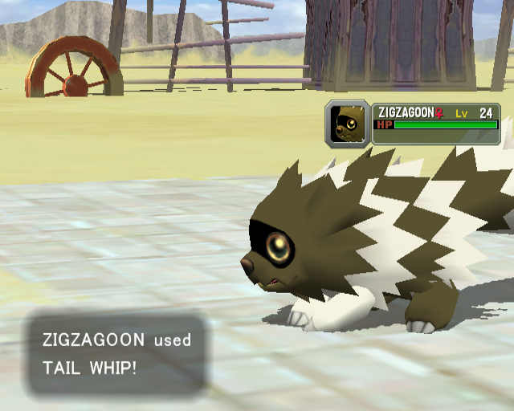
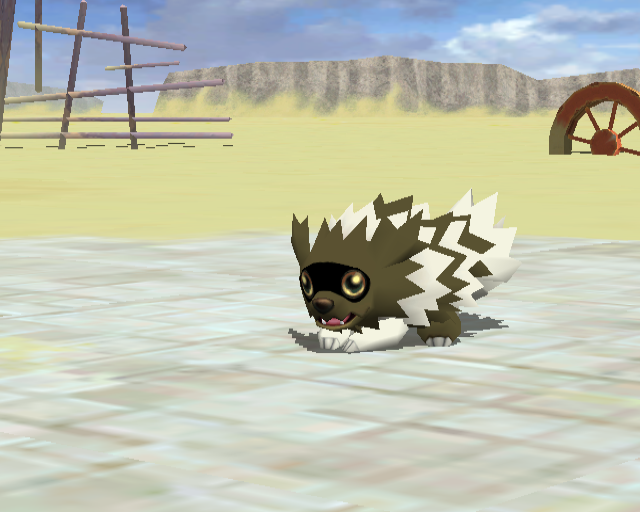
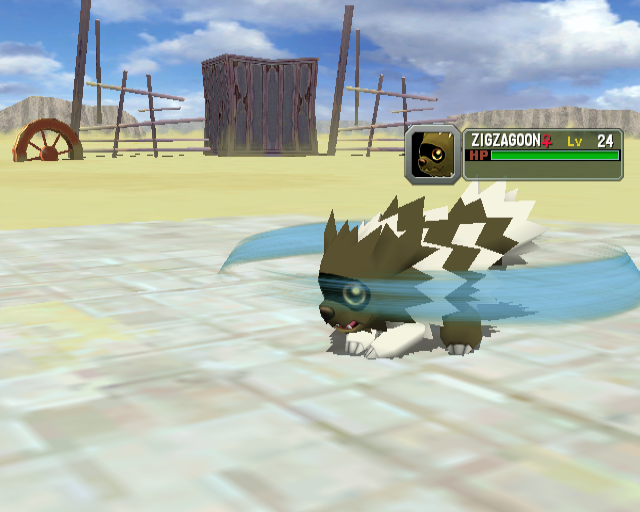
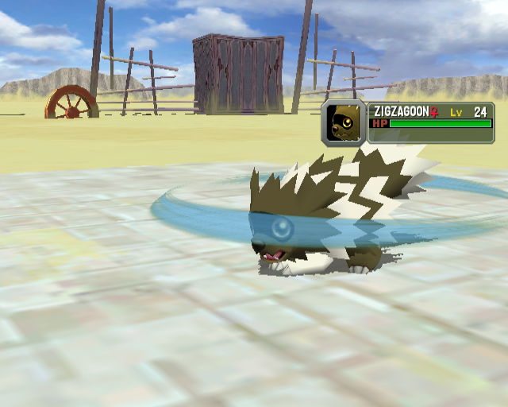
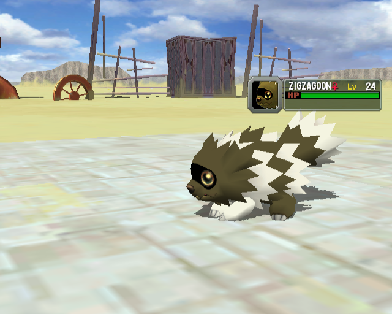
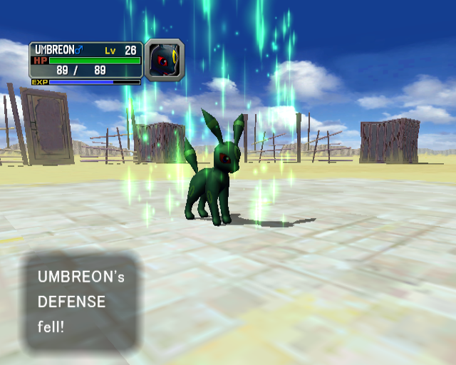
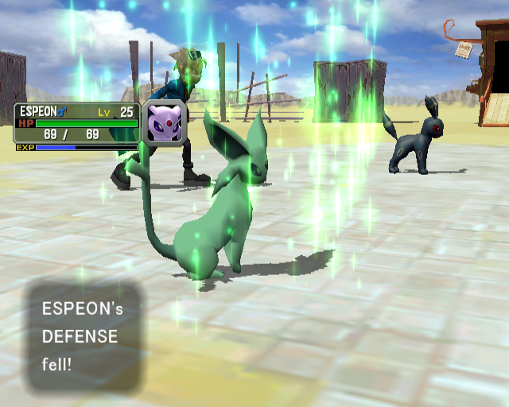
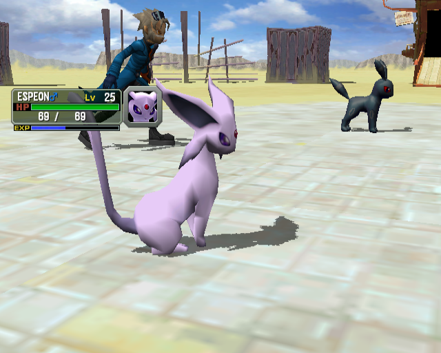

# Original Tail Whip reference and bounded comparison

These are actual original-game Dolphin captures, separate from the
[native 5539f43 hardware checkpoint](../tail-whip-hardware-2026-10-23/README.md).
They replace the earlier missing-original-reference gap. They do **not** establish
native/original visual parity, shared RNG, matched camera/effect age, or performance.

## Exact capture identity

The ordinary-controller DSU tool is `tools/dolphin_dsu.py` from Colosseum3DS
source `6864e7e3bb7500a8387a7964cc17b60684af5de8`, SHA-256
`546d341f187cad2bf3f5d704b4897dc060487e3e09c3f7a5e373c5a721c4c8e7`.
The original-game executable is SHA-256
`5e076628b977603dcde9ddef5eedf10b5a9ce0b6208bd4e6dfa9039cdebf3433`,
official Dolphin source pin `5e7cc91d8c9a43ca189b288937f65c9763af9c22`.
The RVZ is SHA-256
`f278e568b5c2dafb153ec932edc95051146cecf5ebc1d3843d71745cd0c1861e`.
No game executable, disc, save or configuration bytes are published here.

A verified ordinary-controller prefix performed Umbreon CALL and stopped at
Espeon's main menu; screenshot-gated DSU A/DOWN/A selected REFLECT. The original
opponent then used Tail Whip on that first nondamaging turn. This run did not
write game memory or select a native-matched RNG seed. The isolated card remained
SHA-256 `7e1cb3159756293bf938fd922fe45e82448d1b667f6833a48da351af3cbd0f23`
before and after capture.

The explicit announcement says **ZIGZAGOON used TAIL WHIP!** and the actor HUD
shows a female Zigzagoon at level 24. This identifies the observed original
action, **not an original A/B party slot**. The native checkpoint's B-slot claim
comes from its separate native trace/roster and must not be inferred from this
reference's gender or screen position. A later original Tackle announcement is
a separate action and is not used to label the cyan rings.

## Unchanged selected frames and viewing proxy

The eight PNGs retain their original 640×512 backing pixels. Their intended
sample aspect is 16:15; compare display aspect explicitly rather than treating
raw width/height as square-pixel geometry. All image/frame identities are in
[the manifest](manifest.json).

The [silent viewing proxy](original-tail-whip-reference-silent-30fps.mp4) covers
dump frames 9180–9449. It has 135 frames at encoded 30 fps, 4.5 seconds,
640×480, 858,077 bytes, SHA-256
`80b832ceea5c2702e548251c5f97c3eae9d74984a5cbb05e1678829b9cdf8516`.
The existing proxy rescales 640×512 to 640×480; the PNGs above are unchanged.
Its 60-dump-frames/second to 30-fps convention is for viewing, not a measured
original game frame rate or synchronization with NTR. Full FFmpeg decode exits 0.
There is no audio stream.

## Separate defender stat-down effect gap

After the caster's cyan rings, original Umbreon and Espeon receive green
vertical streaks/tint with their respective **DEFENSE fell!** messages:

These generic defender stat-down visuals are distinct from Tail Whip's caster
drawable/controller. The current native caster slice and typed status messages
do not implement that original generic visual effect. The successful native
attack/cue teardown must not be described as complete Tail Whip presentation.

## Visual verdict: category match, comparison revision required

The [structured verdict](visual-verdict.json) scores **76/100, revise**, below
the 90-point pass threshold, with `category_match=true`. Native
[`tail-band.png`](../tail-whip-hardware-2026-10-23/tail-band.png) and the verified
original frames share the cyan/blue horizontal-ring category. The native capture
is an extreme head/trainer-foot crop; the original exposes a wider actor view.
Camera/RNG variant and effect age are unsynchronized. Original 640×512/SAR16:15
and native 283×240 scene viewport plus diagnostic HUD also prevent direct
pixel alignment and apparent-scale comparison.

This is a request to revise the comparison setup, **not evidence for an invented
geometry or camera correction**. Select matched authored effect/controller
phases and owner-relative camera/FOV, then compare source center/yaw/class scale,
texture/material state and timing. Until then, radius, arc count, thickness,
attachment and alpha differences cannot support a pixel/retail-fidelity pass.
Hardware execution, original-reference identification, audible fidelity, generic
stat-down coverage and full-speed performance remain separate gates.
