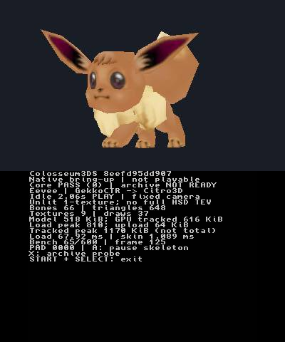
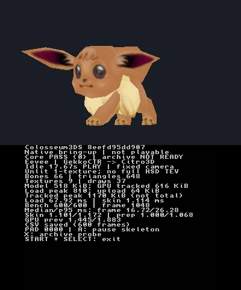
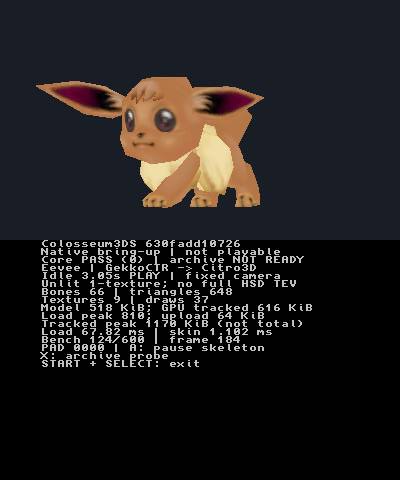
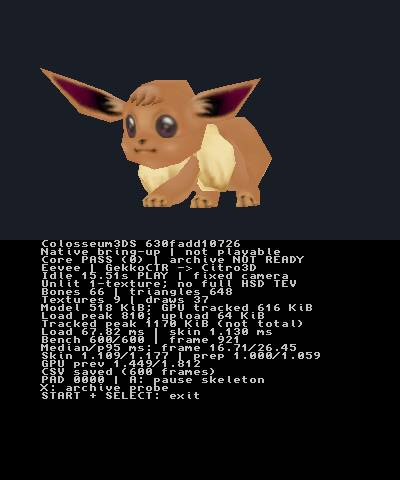

# Eevee scene hardware validation — October 21, 2026 (Hawaii)

## PR #2 review repair revalidation

The corrected implementation was physically tested from source
`8eefd95dd907271bc51615850b3a127880fcd7cf`. Its executable is **219580 bytes**,
SHA-256 `d6a153fa005124808a1c3d57675054ef598eafda28e3134b358ffb9f4f13b295`.
The implementation was committed before building, assembling the pinned P5
shader with Picasso, linking and deploying. Later evidence-only commits have
their own build identifiers; their CI artifacts are not this tested binary.

The maintained donor adaptation now owns shader bytes until program and DVLB
destruction, including partial initialization cleanup, after the GPU queue drain.
Installer comparisons match case-insensitive SD names while retaining server
spelling. Animation normalization keeps both palette indices in bounds for tiny
negative times; this repairs the reusable API boundary, not an observed crash in
the nonnegative-time console preview. Navigation rechecks current receiver
errors, both timestamps and unique screen classification after saving evidence,
and records the actual frames authorizing each input.

Focused regressions reject the former premature shader free, uppercase/mixed-case
model and directory aliases, tiny-negative animation overflow, and contradictory
frames received during evidence saving. The shader lifecycle harness executes
generated initialization/cleanup, covers partial failures and repeated shutdown,
and its restored-premature-free control reports ASan heap-use-after-free. The
new animation cases report ASan heap-buffer-overflow against the old source.
Old installer/navigation implementations fail the new focused tests; corrected
tests pass. Source verification, four native suites, a forced ASan/UBSan rebuild,
all **95 Python tests with Pillow 11.3.0 and zero skips** (WSL), and the pinned
ARM/Picasso build passed. The implementation-head local-runner
[CI run](https://github.com/dougchansan/Colosseum3DS/actions/runs/39703945689)
passed host, capture and New3DS jobs. A separate read-only review found no
actionable issues in the repairs.

The isolated deployment at `/3ds/Colosseum3DS/scene-8eefd95dd907/` passed staged
and final readback verification. The original nested application hashes and
model pack hash were checked again after exit; all match the prior record.
The identical pack was reused without upload/rename. See
[deployment and preservation](evidence/gekkoctr-eevee-review2-2026-10-21/deployment.json).

Fresh captures at 01:08:15 and 01:08:31 UTC on October 22 (October 21 Hawaii)
show Core PASS, textured Eevee and distinct ear/body poses under the stationary
camera. Both latest screen ages were below 0.1 seconds. A produced the
[PAUSED state](evidence/gekkoctr-eevee-review2-2026-10-21/paused.png);
fresh top-screen images roughly nine seconds apart were pixel-identical.
A second press [resumed PLAY](evidence/gekkoctr-eevee-review2-2026-10-21/resumed.png).
START+SELECT [returned to HBL](evidence/gekkoctr-eevee-review2-2026-10-21/clean-exit.png),
and [relaunch](evidence/gekkoctr-eevee-review2-2026-10-21/relaunch.png) succeeded.

The corrected navigator completed model → ftpd in **12.938 seconds** and
ftpd → model in **16.438 seconds**, including title startup. The new isolated
directory requires one additional DOWN step. Initial recalibration stopped on
an unmatched animated launcher crop; after restoring the established crop
tolerance, both complete routes passed within the existing limits. Every
dispatch has current authorization metadata in the
[route record](evidence/gekkoctr-eevee-review2-2026-10-21/navigation-timings.json).
The console was left running the corrected model scene.

The repeated 60-warmup/600-sample benchmark spans **10.027137 seconds**, with
NTR streaming active and no input during sampling. No installed NTR files or
settings were changed; a streaming-disabled comparison remains unmeasured.

| Measurement | Median ms | p95 ms | Previous median ms |
| --- | ---: | ---: | ---: |
| Application wall frame interval | 16.719 | 26.279 | 16.710 |
| CPU interpolation/skinning | 1.101 | 1.172 | 1.109 |
| CPU material/draw preparation | 1.000 | 1.068 | 1.000 |
| Previous GPU drawing time | 1.445 | 1.883 | 1.449 |

Load/setup was 67.922 ms (previously 67.817 ms). This single short run shows
no material performance regression; it does not establish statistical equivalence.
Geometry and tracked allocation counts are unchanged. Retained shader storage
is excluded from the existing tracked-memory subset, so the unchanged 1198128-byte
figure is not a claim of unchanged total RAM. See the new
[raw CSV](evidence/gekkoctr-eevee-review2-2026-10-21/benchmark-streaming.csv) and
[summary](evidence/gekkoctr-eevee-review2-2026-10-21/benchmark-summary.json).
The device/firmware and material-fidelity limits recorded below still apply.

## Earlier baseline (retained for comparison)

## Result and identity

One real textured Colosseum Eevee renders through the native GekkoCTR/Citro3D
path on the physical New 3DS family console. Fresh captures show different ear,
head and body poses with the same stationary camera. Core self-tests remain
PASS; the absent `common.fsys` still reports NOT READY. This is one prepared
model scene, not a playable game or a representative battle benchmark.

Tested application source: `630fadd1072620652712197ca1f540fdc9220356`.
Executable: 219548 bytes, SHA-256
`99019aa23ae6ad007da4e05e40f78615746e22a0b6c3d062fb11c775549bee2d`.
SMDH: 14016 bytes, SHA-256
`aa4ea04bc11d878a77367dd4ac801367070b140108c7b16cedee49f83834daf6`.
The subsequent report/navigation/admission changes do not constitute a new ARM
hardware test. CI artifacts embed their own build commit and may differ in that
identifier; do not relabel this tested binary as an untested later executable.

The pack is 299112 bytes with SHA-256
`20aeca58879947b2ee58a2537a5365e858bd6b3f04aaad898eae56972592f625`.
Archive/member identity, geometry/material counts and bake verification are in
[asset-preparation.json](evidence/gekkoctr-eevee-2026-10-21/asset-preparation.json).
All 41 baked frames passed the independent GX-world deformation check; maximum
transformed vertex error was `1.6158e-7` meters against a `1e-4` tolerance.

The original nested application was downloaded and verified before writes. The
new executable was installed only in
`/3ds/Colosseum3DS/scene-630fadd10726/`, with the pack at the fixed application
data path. Every staging upload and final file was downloaded and hash-checked.
The original executable was neither replaced nor relocated, and existing saves
and unrelated contents were not modified. See [deployment evidence](evidence/gekkoctr-eevee-2026-10-21/deployment.json).
An earlier rear-camera development scene remains in its separate commit directory.

## Visual and control evidence

These images were captured at `2026-10-22 00:03:28 UTC` and `00:03:41 UTC`
(October 21 in Hawaii) and opened for inspection. Their latest top/bottom frames
were less than 0.1 seconds old at capture end. The capture metadata records
93/93 and 54/53 received top/bottom frames, respectively. Visible limb/ear changes
are skeletal pose changes; the camera and model root are not rotated as a demo.
Received video counts are not the application's FPS.

[A paused capture](evidence/gekkoctr-eevee-2026-10-21/paused.png) shows the PAUSED
diagnostic. START+SELECT returned cleanly to Homebrew Launcher on both scene
builds. Relaunch through the recorded directory succeeded. HOME navigation to
ftpd and back was observed, including explicit confirmation dialogs. This is
not an exhaustive HOME/lid lifecycle acceptance test; lid sleep was not tested.

## Repeatable measurement

After 60 warmup frames, the app records 600 consecutive unpaused samples. The
reported run spans **10.028202 seconds** of wall-frame intervals with NTR
streaming active. No controls, camera changes or SD writes were performed inside
the sample window. CSV output occurs after sampling completes.

| Measurement | Median ms | p95 ms |
| --- | ---: | ---: |
| Application wall frame interval | 16.710 | 26.453 |
| CPU matrix interpolation/skinning | 1.109 | 1.177 |
| CPU material/draw preparation (excluding frame-begin pacing) | 1.000 | 1.059 |
| Previous frame's Citro3D GPU drawing time | 1.449 | 1.812 |

Mean frame interval was 16.71367 ms; maximum was 30.162 ms. Loading the prepared
pack plus renderer/shader/texture initialization took **67.817 ms**. A streaming-
disabled comparison was not measured. Closing the PC receiver does not disable
NTR on the console, and no such disabled-state assumption is used here.

Each frame submits **37 draws, 1944 vertices and 648 triangles**, using nine
textures and 66-bone sampled palettes. Draws preserve triangle/material boundaries
across the old 64-vertex frontend limit.

| Tracked memory | Bytes |
| --- | ---: |
| Prepared file | 299112 |
| Resident model/blob, parsed arrays and animation palettes | 530480 |
| Temporary model-load peak, including duplicate input copy | 829592 |
| GPU linear vertex arenas and texture storage | 630784 |
| Largest upload staging buffer | 65536 |
| Combined peak of the tracked load/upload subset | **1198128** |

These are tracked allocations, **not total process RAM**. Driver/command buffers,
render targets, shader internals and static BSS (including profiling arrays) are
excluded. Offline Blender's approximately 230 MB host working set is separately
labeled in the preparation manifest and is not 3DS memory use.

Raw numeric [600-frame CSV](evidence/gekkoctr-eevee-2026-10-21/benchmark-streaming.csv)
and [summary with hashes](evidence/gekkoctr-eevee-2026-10-21/benchmark-summary.json)
are included. No original model, texture, animation or pack bytes are committed.

## Observed hardware and tooling

- Device detection: New 3DS family; exact model variant remains unverified.
- New 3DS speedup was requested; actual CPU MHz was not measured.
- Homebrew Launcher displays `Rosalina v2.4.3`; this is not a Luma firmware version.
  Exact Luma version is unverified.
- ftpd HOME label and running header show **3.2.1**, TCP port **5000**.
- Installed BootNTR files were inspected read-only. `ntr.bin` contains `NTR 3.6.1`
  (SHA-256 `04da7026e8738dfcdc0af88a308e587cb3127aa2a02a03bc73762601db04b56d`);
  `ntr.hr.menu.bin` contains `NTR 3.6 HR`
  (SHA-256 `1e1537fc5677af94a24ba876ac5c969593b6fc66463194eb27be49dd7bda0f38`).
  The owner reports HR loaded. Those installed files are not an attestation of
  the exact active HR release, which remains unspecified. Selector labels alone
  were not used to identify the engine.
- Capture: project Python original-JPEG client with Pillow 11.3.0, receive-only
  UDP8001 after reusing the already-running stream. NTR TCP8000 stopped accepting
  connections while video continued; `--listen-only` recovered fresh visibility
  without restarting or modifying the installed engine.
- Build: pinned devkitARM Docker image `116afba8...e0bbf5`, GCC 16.1.0 / r68-1,
  libctru 2.7.0-1, Citro3D 1.7.1-2, Picasso 2.7.2-3, 3dstools 1.3.1-3.
  Full digest remains in the workflow and integration guide.

No firmware, boot files, system configuration or NAND was modified. All console
writes were the new application scene, prepared application data and its own
benchmark logs.

## Mapped navigation follow-up

At the owner's request, a small calibrated navigator now retains one NTR UDP
receiver, caches static UI templates and waits for fresh stable states instead
of launching a fixed two-second capture after every press. It uses the same
bounded Luma action/release routine, allows at most 12 actions with a 90-second
navigation budget (in-flight cleanup may complete beyond it) and
stops on unknown, ambiguous, stale or unexpected screens.

Observed end-to-end routes were **12.922 seconds model → ftpd** and
**15.140 seconds ftpd → model**, including title startup. The final state was the
running Eevee scene. [Navigation timings](evidence/gekkoctr-eevee-2026-10-21/navigation-timings.json)
record every verified step. Early calibration trials stopped safely when animated
backgrounds or menu settling prevented a match; they did not continue blindly.
Private calibrated references and endpoint configuration stay outside Git.

## Limits and next step

The scene deliberately simplifies materials and uses one-influence CPU skinning
with offline sampled palettes; see [supported subset](gekkoctr-model-scene.md).
Actual game timing, full HSD material fidelity, multiple characters, battle
performance, total RAM and streaming-disabled timing are not established.
The next integration should connect original HSD joint/material traversal to
this native seam, adding multi-weight envelopes and lighting with a separate
representative scene acceptance gate.
