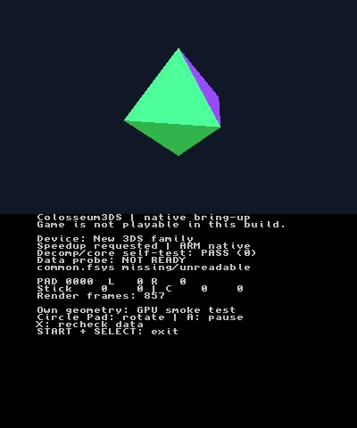
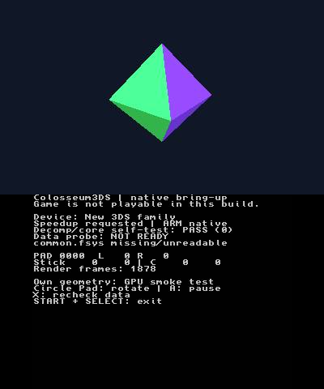

# Hardware workflow checkpoint — October 21, 2026 (Hawaii)

This is a partial acceptance record. The original executable was downloaded
from the physical console and verified. Fresh decoded frames of both application
screens were captured and opened, showing rotating geometry, passing native
self-tests and the expected missing-data diagnostic. No application or game data
has been written to the console in this session.

## Installed executable and local build

Application source baseline: `d68267ba316f62b9918112a0c38a5dbeea63637f`.
The installed files were found at
`/3ds/Colosseum3DS/3ds/Colosseum3DS/`, inside the supplied package directory.
The normal direct application path contained package documentation and that
nested directory. The files were preserved in place and backed up locally.

| File | Bytes | SHA-256 (installed and freshly built) |
| --- | ---: | --- |
| Colosseum3DS.3dsx | 181088 | `75d5c4b93781f68bf25f3cc8f58d49376d70e2564d793f3101eff3b4d0a167a8` |
| Colosseum3DS.smdh | 14016 | `aa4ea04bc11d878a77367dd4ac801367070b140108c7b16cedee49f83834daf6` |

The fresh build used `make -f Makefile.3ds -j2` in the local Docker image
`devkitpro/devkitarm@sha256:116afba8df8453961de2936ffab20dd441edf4d682856c1ec8b0e53d7ed0bbf5`.
Recorded packages: devkitARM r68-1 / GCC 16.1.0, libctru 2.7.0-1,
citro3d 1.7.1-2, Picasso 2.7.2-3, 3dstools 1.3.1-3.
Byte identity links the inspected installation to the reproducible baseline;
it does not establish any unobserved hardware behavior.

## Console acceptance

| Check | Result | Evidence / limit |
| --- | --- | --- |
| Passive FTP read | PASS | Both application files downloaded and SHA-256 checked |
| Launch and rotating geometry | PASS | Fresh captures 03/04 show different orientations; owner also confirmed launch |
| Native self-test | PASS | Bottom screen: Decomp/core self-test: PASS (0) |
| Missing-data NOT READY | PASS | Bottom screen: common.fsys missing/unreadable; rendering remains active |
| Real archive on console | NOT TESTED | No data deployment performed |
| A pause/resume | PASS | Captures 06/07 have identical top-image hashes with advancing render counters; capture 08 resumes movement |
| Circle Pad / C-stick | PASS (positive X sample) | Injected +0.5 gives diagnostic 58 / 72, then both return to zero |
| L / R | PASS | Each displays 255 while held, 0 after release |
| ZL / ZR | PARTIAL | ZR held capture shows mapped PAD 0010; ZL sample retained for review |
| Remaining buttons / axis directions | NOT TESTED | B and DOWN navigation observed; exhaustive in-app matrix remains open |
| START+SELECT exit and relaunch | PASS | Capture 09 shows launcher; observed nested navigation; capture 16 shows reset render counter and self-test PASS |
| HOME suspend/resume and close | NOT TESTED | Test separately from NTR |
| Lid sleep/resume | NOT TESTED | Requires physical action |
| NTR video, both screens | PASS | Captures 03/04: 159/158 and 100/99 decoded top/bottom frames, all final ages below 0.1 s |
| Luma input redirection | PASS (bounded actions) | Observed A, exit/relaunch, positive axes and L/R responses; neutral release checked |
| Guarded deployment on console | NOT TESTED | Installed binary already matches fresh build; no replacement needed |

Console model: New 3DS family per handoff; exact model unverified.
Luma and ftpd versions: unverified. Homebrew Launcher screen showed Rosalina
v2.4.3 (launcher label, not a Luma firmware version). ftpd port was confirmed
on its screen as 5000; FTP greeting was `220 Hello!`, which does not identify
its version. BootNTR Selector was described in the handoff as Enhanced 3.6;
loaded engine was subsequently reported by the owner as NTR-HR, without an exact
engine version. NTRViewer-HR Lite v0.3.8.3 was fetched and briefly launched with
zero video frames. Source inspection revealed automatic input/neutral forwarding;
it was closed, and no view-only guarantee is claimed for that preliminary viewer.
All successful recorded captures use the input-free Python client instead,
with Pillow 11.3.0. No firmware, NTR installation or system configuration changed.

The view-only Python implementation follows the original JPEG protocol from
NTRViewer-HR source commit `556c6d06b21cef38c29efd0cdad59a5771956268`.
Only TCP heartbeat/view commands are supported; UDP is receive-only.
Capture 03 ended at 22:46:15 UTC and capture 04 at 22:46:32 UTC. Both were opened
and inspected. Geometry orientation changed while the diagnostic remained stable;
earlier fresh captures showed HOME then Homebrew Launcher, proving visible state
transitions. Received video counts are not application frame-rate measurements.

Sanitized metadata: [capture 03](evidence/colosseum-20261021-03.json),
[capture 04](evidence/colosseum-20261021-04.json).

The owner subsequently requested Luma control, superseding the earlier view-only
constraint. The capture client remains input-free; controller actions use the
separate bounded driver. A press paused geometry: captures
[06](evidence/colosseum-20261021-06.png) and
[07](evidence/colosseum-20261021-07.png) have top JPEG SHA-256
`49491c8dbe9af94504b756e493f178bc211cee94f1a1a21891df15ce2e6ff3c8`
while the bottom render counter advances from 8496 to 9119. A second A resumes
rotation. START+SELECT returns to the launcher, and observed navigation reaches
`sdmc:/3ds/Colosseum3DS/3ds`, whose Colosseum entry launches the known nested
executable. [Capture 16](evidence/colosseum-20261021-16.png) confirms relaunch.

Input samples: [Circle Pad](evidence/input-circle-retry-held.png),
[C-stick](evidence/input-cstick-held.png), [L](evidence/input-L-held.png),
[R](evidence/input-R-held.png), [ZL](evidence/input-ZL-held.png),
[ZR](evidence/input-ZR-held.png). Sanitized timestamps, release counts and final
frame metadata are in [input observations](evidence/input-observations-2026-10-21.json).
All samples were opened and inspected along with neutral post-release frames.
These are injected input checks, not tests of physical button switches.

Concurrent image/metadata reads exposed a Windows sharing violation during the
first Circle Pad sample. That capture correctly reported `output_error`.
Publication now retries transient PermissionError within 40 ms and remains fatal
on persistent errors; the Circle Pad sample was repeated successfully. This was
a PC evidence-publication issue, not a console failure.

The PC's Ethernet interface reached FTP. After the requested app launch,
FTP refused connections; ordinary ftpd is not assumed to remain active.
Private endpoint addresses, local full logs, backups and originals remain
in ignored local storage.

## Local validation and data availability

`make verify-source` verifies all eight exact pinned hashes after restoring LF
checkout bytes. Windows Git's CRLF conversion initially caused the hash check
to fail; the expected hashes and upstream commit were not changed.
The host C tests pass, including six FSYS/LZSS groups and 30 Pokémon checks.
The Python suite includes synthetic FTP failures; none of those tests establish
real hardware deployment or rollback support.
All 24 transfer tests pass, including renames applied before a lost reply,
readback mismatch, interrupted recovery and preservation of unknown active bytes.
All three C executables also pass AddressSanitizer and UndefinedBehaviorSanitizer
in the local GCC 13 container. This Python-only change has no repository lint or
typecheck configuration; Python compilation and `git diff --check` are used in
addition to the tests. Capture has 13 passing tests and controller input has
six, including publication failures, freshness and error-release behavior. The
Linux full suite discovers 46 Python tests, passing with one optional Pillow
image test skipped; all 43 new tests pass on Windows with Pillow. The pre-existing
input-verifier symlink test requires Windows symlink privilege and fails there;
it passes in Linux. No system privilege setting was changed.

CI is independent: the historical run `39684365653` failed before runner steps,
with no diagnosed compiler failure. New PR run
[`39688776329`](https://github.com/dougchansan/Colosseum3DS/actions/runs/39688776329)
also failed both jobs before any steps ran. Its host check annotation explicitly
attributes non-start to failed recent payments or a spending limit that needs
increasing, and directs the owner to Billing & plans. This identifies an account
billing gate for the new run; it is not a compiler failure. No billing settings
were changed. The local build and hardware observations do not constitute a CI pass.

The private input repository was checked out at the pinned
`eae433c46b8b968dd7dcab72cf85351c8b9c7966`; `tools/verify_inputs.py` verified
26/26 originals. A local GC6E01 revision 0 extraction was found and
`prepare_data.py` successfully staged 656824337 bytes to a new local directory
outside the repository after checking disc identity and the canonical DOL hash.
The files have not been copied to the console.

An exploratory local ctypes harness compiled the unchanged `src/data.c` as a
shared library and decoded all 32 members of its 743136-byte `common.fsys`
with an 8 MiB per-member output limit. Every native output matched the pinned
upstream Python decoder. Decoded `common_rel` also matched the verified private
original. Archive SHA-256:
`f83b73c524498c1ec3ea1c04d06d391bcd6ca7e1ddd318fa33bcca0d6cf5b19a`.
This is host compatibility evidence, not a 3DS archive result. The exploratory
harness and outputs remain private; the committed synthetic tests are the
repeatable public regression suite.

## Repeat and next gate

Follow [hardware-workflow.md](hardware-workflow.md). Fresh top/bottom capture is
established, as are the bounded controller and exit/relaunch checks above. The
nested launch path is now observed; preserve its original files before any
installation layout correction. Keep this PR focused on guarded transfer,
capture/control and the measured checkpoint. Exhaustive controls, HOME/lid
lifecycle and real console replacement remain unverified.

Next porting milestone: decode one explicitly identified real archive member
on the 3DS with an allocation ceiling and visible byte count/error status.
Acceptance: host/reference byte identity, console archive success and failure
diagnostics, bounded memory, preserved rendering/input, and fresh screenshots
of the exact tested build. A decoded REL is data/reference only and cannot run
as ARM code.
