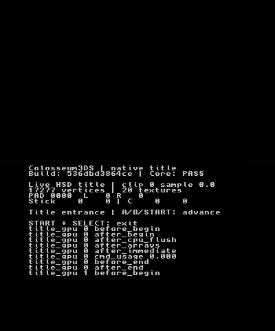
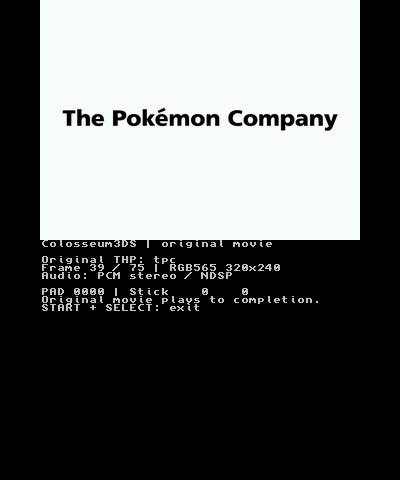
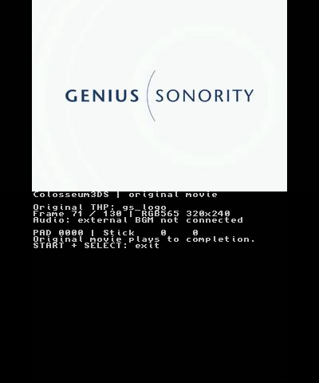
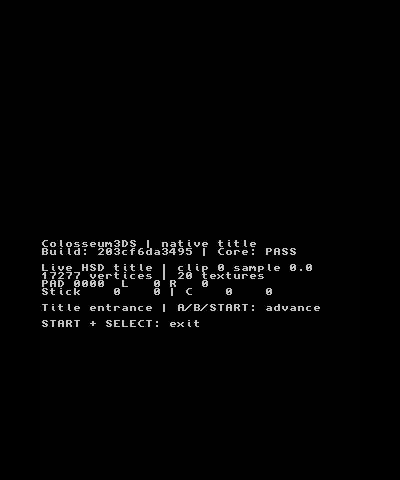

# Native first-area physical acceptance — October 22, 2026 UTC

## Status: incomplete at the first live title frame

The separate `feat/native-first-area-hardware` worktree follows
[native-first-area-handoff.md](native-first-area-handoff.md), based on
`8b3e7052ad951b606abc3be028429889353469e8`. PR #2's worktree and branch remain
unchanged. This is physical New3DS evidence, separate from the earlier emulator
validation. **New Game through Outskirt Stand and Save/Continue have not passed
physical acceptance.**

The initial run exposed a real ARM11 data abort. After that specific fault was
repaired, the app remained alive enough for fresh NTR capture but stalled at its
first title draw. The next committed diagnostic build is ready; device recovery
is required to install it. Do not interpret this report as a completed first-area
gate or use the earlier Eevee benchmark as field performance.

## Cooperative control recovery implementation (not yet deployed)

The subsequent user-requested control change supersedes the unrun controlled
probe. The implementation now returns BUSY immediately, keeps CPU input/trace
handling active, displays a watchdog recovery view, and defers resource release
until GPU quiescence. Temporary probe stages and console markers are removed.
[Recovery controls, ownership and limits](render-recovery.md) describe the exact
behavior, including the Citro3D HOME suspend-hook limitation.

Ready source `7a4a74613d01e3a4598da6e26c14f5bb701be83f` builds a 315324-byte executable,
SHA-256 `d068396046553294eb597f7e38996e3fa393865a8f36e90928e5bbe65fc2b1a1`.
Host verification covers 734 recovery checks, eleven native suites/ASan/UBSan,
and 134 Python tests with NumPy/Pillow and zero skips. The pinned ARM build passes.
This binary remains uninstalled because the older 536 diagnostic is still frozen.
Hardware acceptance and the original title-stall root cause remain unverified.
The next action is recovery/deployment of this runtime, not the historical 654
probe described below.

## Subsequent title-stall isolation (historical probe)

The first diagnostic (`536dbd3864ce`) was deployed with readback verification.
Fresh NTR captures show `title_gpu 0 after_end` followed by
`title_gpu 1 before_begin`. Thus the initial draw call returns, and the next
`FrameBegin(SYNCDRAW)` blocks. This does not yet distinguish VBlank event
synchronization from an unfinished GPU queue. The displayed pre-end command
usage of zero was the SDK's cached initial value, not proof of no commands.

The preserved [repaired run trace](evidence/native-first-area-hardware-2026-10-22/repaired-stall-trace.log)
still ends at `title_begin`. No save directory existed in the subsequent
successful listing. The asset set and saves have not been changed.

A controlled probe is now committed as `65469d1235ba585b429a5ce52860667539b0efb9`:
312996-byte executable, SHA-256
`f04be43b89a1e37e7f86731bfdfab9c64d9399a7823825999ed5ef34f7676781`.
It submits clear-only, geometry-only, geometry plus the original overlay, then
normal rendering. It polls `NONBLOCK` without `SYNCDRAW`, records both frame
counters, and reports a three-second queue deadline. A timed-out probe parks
without freeing GPU-owned storage. Five executed host tests cover the sequence
and simulated timeout; strict/ASan/UBSan and the pinned ARM build pass.
This is temporary isolation code, **not a claimed stall fix**. It has not been
deployed because the console still needs reset/FTP recovery. Remove the probe
and temporary console markers once the failure has been isolated.

## Exact source and binaries

| Build | Commit | 3DSX bytes | SHA-256 |
| --- | --- | ---: | --- |
| Initial, crashed | `8b3e7052ad951b606abc3be028429889353469e8` | 311216 | `5303d913b44bd68857c585cae4aae0476efb355ba954a97dba8a6327e5766640` |
| Null-binding repair, physically tested | `203cf6da34957d058de2dcb462a8daefeca99a57` | 311228 | `6f28bec622eabdac9b3df614e78728b2a049795c15b3dfb7237370a53fdf2388` |
| Bounded frame diagnostic, subsequently tested (see above) | `536dbd3864ce21f196439860f2a1889a4c9b3072` | 311956 | `4254c47bd712d5fcce72e1c46ebbb4f9b7b9d92a82af4238c0f3f26eb29e834f` |

Both normal builds retain the Gekko route and choose native boot from `boot/`.
SMDH is 14016 bytes, SHA-256
`f3fad3feb7b42caab0a647bb392050bf72e4507593cded5a16819cc1c68e5a55`.
The implementation and diagnostic were each committed before their hardware-test
builds. A subsequent report commit has a different build identifier; its CI
artifact must not be relabelled as either physically tested executable.

Pinned Docker toolchain: `devkitpro/devkitarm@sha256:116afba8df8453961de2936ffab20dd441edf4d682856c1ec8b0e53d7ed0bbf5`,
devkitARM r68-1/GCC16.1.0, libctru2.7.0-1, Citro3D1.7.1-2, Picasso2.7.2-3.
The [source pins](evidence/native-first-area-hardware-2026-10-22/source-pins.json)
are unchanged. Windows worktree builds mount both worktree and parent Git
metadata paths and explicitly set the verified commit's `C3_BUILD_ID`; see
[build record](evidence/native-first-area-hardware-2026-10-22/repaired-build.json).

## Confirmed fault and narrow repair

The owner's crash photo showed ARM11 core 0, `3dsx_app`, data abort,
Translation–Section, Read, PC `0011ABF0`, LR `00109724`, FAR `0000000C`, R0=1,
R1=0. The exact failed ELF resolves PC to `C3D_TexGetType` inside `C3D_TexBind`
and LR to the unit-one binding in `title_renderer.c`. Disassembly at PC is
`ldr ip, [r1, #12]`. Saved `crash_dump_00000001.dmp` contains the matching PC
word; original dump/ELF/photo bytes remain private.

Citro3D 1.7.1 reads the texture type for a texture unit above zero. The renderer
passed NULL both when a material did not use unit one and when preparing its
fade overlay. The repair binds the existing valid base texture on unused unit
one and retains valid bindings during the primary-color-only overlay. It adds
no texture allocation and preserves the combiner's selected inputs.

The host fixture executes the production `c3_stage_renderer_draw` function
against a binding contract. It covers single, dual, reflection and fade paths.
Restoring the old calls reproduces NULL-unit-one failures for single-texture
geometry and dual/reflection fades; corrected cases pass. This tests CPU binding
control flow, not GPU output. The photo/ELF/dump establish the actual hardware
fault separately. [Machine-readable diagnosis](evidence/native-first-area-hardware-2026-10-22/initial-crash.json).

## Preparation, deployment and preservation

All six preparation groups produced **14 files / 387614826 bytes**, with the
exact filename/length/hash set matched to converter manifests. Full streaming
STOR, staged RETR SHA-256, rename, and final RETR SHA-256 checks passed for every
file. The opening pack is 304066812 bytes and was never read whole for transfer
verification. The complete transfer and verification took 861.496 seconds.
[Asset identities](evidence/native-first-area-hardware-2026-10-22/assets.json).

The extracted disc lacks loose `common_rel.rel`; the unchanged New Game
converter succeeded with a private overlay containing the admitted canonical
REL (`e816761813900aa0fd4f87d012b3b2a19d2f003e`) and the verified disc sys files.
The original extracted tree was not modified. No synthetic GCI was installed.

The local Windows title pack hash differs from the prior emulator record.
An independent Ubuntu preparation has identical geometry, textures, metadata
and admitted inputs, differing only in near-zero sampled float residuals with
maximum absolute difference `3.55e-15`. The earlier pack bytes are unavailable,
so this does not prove a byte-level explanation for its hash. The actual
hardware title hash is recorded in the asset set; no baseline hash is reused.
[Host comparison](evidence/native-first-area-hardware-2026-10-22/title-host-comparison.json).

Successful FTP listings established no preexisting `saves/`, `boot/` or
`boot-trace.log` before work. The nested original app was backed up locally and
retained in place. Verified direct copies resolved the known nesting, after
which the guarded deploy backed up the direct originals. Both native builds
passed staged and final application readback. Earlier isolated Eevee scenes,
model data and all application backups remain. No New Game or Save was reached,
so no GCI has been created or replaced.
[Repaired deployment](evidence/native-first-area-hardware-2026-10-22/repaired-deployment.json).

## Observed physical behavior

The original logo timelines completed. The initial run's preserved trace reports:

| Movie | Displayed | Skipped | Elapsed microseconds | Audio state |
| --- | ---: | ---: | ---: | --- |
| TPC (75 source frames) | 49 | 25 | 2509908 | NDSP stereo, result 0 |
| GS (130 source frames) | 129 | 1 | 4355581 | No embedded track; external BGM unavailable |

These are the app's own trace counts and elapsed times, not NTR-derived FPS.
Captured TPC diagnostics show PCM stereo/NDSP. DSP firmware was already present
(49756 bytes). Audible playback and A/V synchronization have not been attested.
No installed CFW/NTR was replaced or updated; the owner reloaded the existing
setup after resetting the crash. [Initial trace](evidence/native-first-area-hardware-2026-10-22/initial-crash-trace.log).

The repaired build shows `203cf6da3495`, Core PASS, title clip 0/sample 0.0,
17277 vertices and 20 textures. Fresh top/bottom NTR frames continue while the
image remains unchanged. Bounded START+SELECT and HOME actions each completed
three neutral releases but caused no visible progress. This is distinct from
the original data abort: there is no new exception evidence, and the blocked
CPU/GPU/synchronization location is not yet established.

The diagnostic commit flushes console markers around frame begin, CPU
preparation, array submission, immediate overlay and frame end for only the
first two frames, plus bounded caller records in `boot-trace.log`. It preserves
`C3D_FRAME_SYNCDRAW` to locate the stall before changing synchronization. These
markers are temporary and should be removed after isolation. Inspect the last
marker and preserved trace after the next run; fresh video alone does not prove
that a game frame completed.

## Verification and remaining acceptance

Nine pinned-source checks, ten native suites normally and under ASan/UBSan,
and all **133 Python tests with NumPy2.4.3/Pillow11.3.0 and zero skips** passed
for the null-binding repair. LeakSanitizer was disabled; ASan/UBSan were active.
The bounded diagnostic fixture also passes strict and sanitized compilation.
Both subsequent normal ARM builds compile and link successfully.
[Host results](evidence/native-first-area-hardware-2026-10-22/host-validation.json).

Remaining physical gates are live title/menu progress; New Game/WES; hideout
movie and bike arrival; field Circle Pad/D-pad movement and starters; explicit
Save/YES; downloaded GCI/trace before relaunch; independent whole-body save
verification; fresh-process Continue with unchanged GCI afterward; sleep/resume;
audible PCM/A-V sync; and field loading/responsiveness measurements. External
music/SFX, NPC dialogue, battles and exits remain unavailable as documented in
the base checkpoint. [Acceptance state](evidence/native-first-area-hardware-2026-10-22/acceptance.json).

The next immediate step is device reset, existing NTR reload and ftpd, then
retrieval of the repaired run's trace and deployment of the ready diagnostic.
After this hardware gate passes, the next engine slice remains Outskirt Stand
NPC/interaction scripts and its first battle. No PR is merged by this work.
