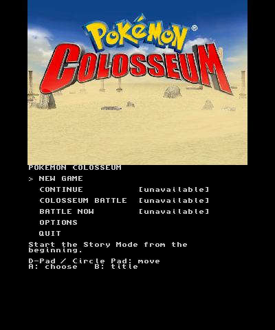
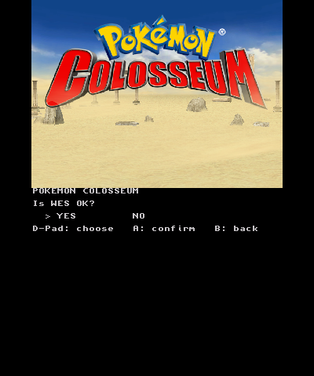
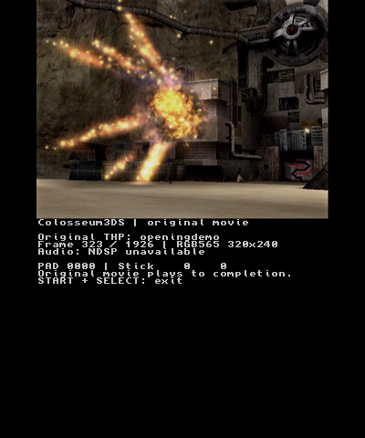
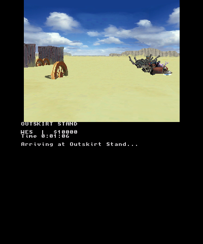
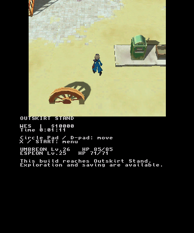
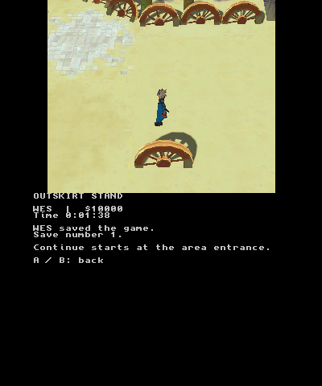
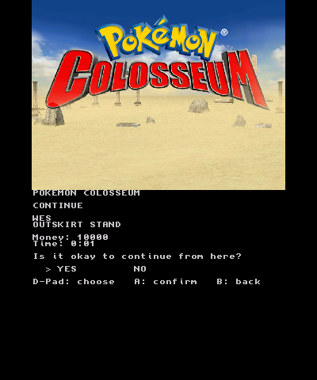
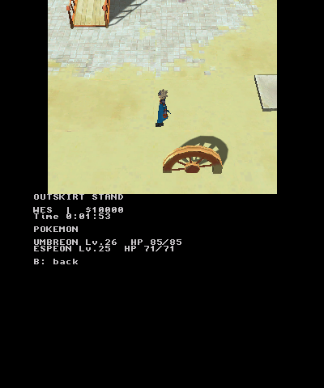

# Native New Game, opening and Outskirt Stand validation

## Result and exact source

The native New 3DS executable completed the requested connected route in an
isolated Azahar run: original boot logos, live title, main menu, New Game,
WES confirmation, the hideout opening movie, the original bike arrival,
Outskirt Stand movement, starter-party inspection, and an explicit Save.
A separate emulator process then selected Continue, restored that save at
the area entrance, moved Wes, and opened the same party without rewriting
the save or replaying the opening/arrival.

The tested implementation is
[`d2af94a8f1b3f0afaa54abe4870ba65052c9b91f`](https://github.com/dougchansan/Colosseum3DS/commit/d2af94a8f1b3f0afaa54abe4870ba65052c9b91f),
with embedded build ID `d2af94a8f1b3`. It is stacked on repaired PR #2 head
`07d4df55cb25ae4ce4ade12904f2cf1348cd418f`. This evidence update changes
documentation, captures and an input-script comment, not the native runtime.
The upstream game, importer and GekkoCTR pins remain unchanged.

This establishes a bounded first-area checkpoint. NPC dialogue, battles,
other areas and the general script engine are still unported. No physical
New 3DS execution, hardware performance, audible playback or retail-console
save acceptance is claimed by these emulator checks.

## Observed connected behavior

| Step | Observed result |
| --- | --- |
| Boot/title | Both original logo timelines complete; original animated title responds to A/START |
| Main menu | New Game, Continue, Options and title return; unsupported battle choices are labelled |
| New Game | WES selected and confirmed; original-data initializer creates trainer `43C70B96`, two starters and 10,000 money; no file write |
| Opening | Original 1,926-frame hideout movie timeline completes; flag `0x08D0` is then set |
| Arrival | Original attached bike geometry/animation and camera run for five seconds, followed by the source fade sequence; flag `0x0AF8` is then set |
| Field | Wes appears at original entrance 0; Circle Pad produces run and walk motion over original map/collision data |
| Party | Umbreon level 26 and Espeon level 25 are displayed with generated source-derived HP/stats |
| Save | Explicit native pause-menu confirmation writes save number 1 at floor 1, previous floor `0x03A0`, entrance 0 |
| Fresh Continue | Save number 1 reloads at entrance 0; movie and arrival are skipped because their flags are present; movement/party menu work |
| Exit | START+SELECT produces clean native `field_end` / `boot_end` records in both runs |

The menu is native bottom-screen text over the original title/field rendering.
The field uses live prepared geometry and animation, including the original
bike arrival. See [native-boot.md](native-boot.md),
[outskirt-field.md](outskirt-field.md) and
[outskirt-assets.md](outskirt-assets.md) for the implementation boundaries.

### Actual captures

| Main menu | Name confirmation |
| --- | --- |
|  |  |

| Hideout movie | Original bike arrival |
| --- | --- |
|  |  |

| Outskirt Stand | Explicit Save |
| --- | --- |
|  |  |

| Fresh-process Continue | Restored party |
| --- | --- |
|  |  |

## Save verification

The independent Python verifier uses the admitted original tables, Python
integer arithmetic, `struct` and `hashlib`. It does not call the C initializer,
C codec or asset preparer. From the logged RNG seed `0239BCC4` and exact saved
binary32 clock bits `42C53073`, it reconstructed **all 122,832 game-state body
bytes** and compared them to the decrypted native save. Every byte matched,
including starter RNG/stat results, inventory/storage defaults, both story
flags, options, play time and checkpoint fields.

| Property | Verified value |
| --- | --- |
| Native save counter / outer generation | 1 / 1 |
| Saved play time | 98.5946273803711 seconds |
| Body SHA-256 | `1a138ed561b3ef32f474f8401dd63ce66a407f7475c5a5b5c5ff63f5bfbc063d` |
| GCI SHA-256 | `b11f0e319d5ca801787ce3fbcd19063e127771a875f231e829f7cb917a5a8c94` |
| Fresh Continue writes | 0; all hashed SD inputs, including the GCI, remained unchanged |

This is an actual New Game created through the connected native UI using the
private source tables. Synthetic codec fixtures are separate tests. No real
user progress was supplied for a retail-save compatibility check. Existing
valid bodies are preserved opaquely, but a later story state still needs the
unported field/event systems. The native Save resumes at an entrance; it does
not add arbitrary-coordinate fields to the original format.

Machine-readable records:
[whole-body verification](evidence/native-first-area-2026-10-22/save-verification.json),
[fresh Continue verification](evidence/native-first-area-2026-10-22/continue-verification.json),
[New Game trace](evidence/native-first-area-2026-10-22/new-game-trace.log), and
[Continue trace](evidence/native-first-area-2026-10-22/continue-trace.log).

## Other completed gates

| Gate | Result |
| --- | --- |
| Host suite | All ten C suites and 129 Python tests passed; NumPy was present, so numeric exporter checks ran |
| Pinned source | Nine native-included source/header identities verified; additional audit manifests record reviewed upstream files |
| Private originals | All 26 canonical DOL/REL SHA-1 values matched; complete disc tree had all 1,872 FST file lengths |
| Original-data game state | 257 checks passed with ASan/UBSan; independent fixed-seed native write/reopen probe also passed |
| Actual field data | 57 portable field checks passed with ASan/UBSan; all seven C3T packs loaded and sampled between every adjacent pose under sanitizers |
| Renderer | Native software-PICA probes passed independent UV, blend, reflection, joint-origin specular, cutout and post-saturation fade pixel expectations |
| Real-map movement | Separate software-PICA probe completed ramp descent with zero missing ground queries and zero moving-frame height error |
| Cross-build | Both the full Gekko-enabled build and focused boot build compiled, assembled shaders and linked with devkitARM |

LeakSanitizer was disabled because this sandbox cannot inspect the required
process/thread metadata. AddressSanitizer and UndefinedBehaviorSanitizer ran.
The full native build retains existing warnings in the prepared Gekko adapter;
the newly connected scene compiled without new warnings.

The separate real-map probe counts 154 draws, 62,277 vertices and 14,154,264
owned GPU-buffer bytes for map plus Wes. That excludes arrival geometry,
decoded asset memory, render targets and command buffers. Its earlier
exploratory wall-contact run reached a time limit and remains marked incomplete;
the final ramp run completed its 700 requested frontend frames. See the
[scoped field-probe record](evidence/native-first-area-2026-10-22/field-probe.json).

## Executables and emulator scope

| Build | 3DSX bytes | SHA-256 |
| --- | ---: | --- |
| Full Gekko-enabled | 311,216 | `d96525cc99e41af67a09e8234b3de48b63e0866238555ec35c8d874eb9b8779f` |
| Focused boot, used for connected runs | 276,332 | `a7deda3e8550ea21d60f157a36b045a455abefd9e8d658bc282c9a921e974d2f` |

The supplied prebuilt Azahar core has SHA-256
`a447e9ecb7b4ef0a530d31eeb83a39edf4697f17bb3e44251f27a1d25fde7662`.
The connected runs used New 3DS mode and OpenGL/llvmpipe. The New Game run
completed 8,750 requested frontend frames; the independent Continue process
completed 3,200. Neither reached its deadline. Frontend frame counts and host
wall times are **not** game render-rate measurements or hardware benchmarks.

The opening's source timeline is about 64.3 seconds. This emulator run displayed
1,795 video frames and skipped 131 late frames while keeping elapsed-time
playback; this is not a claim of sustained 30fps display. Embedded PCM is
prepared and the native NDSP path exists, but this sandbox lacks DSP firmware,
so the trace correctly reports audio unavailable. External MusyX BGM/SFX is
not connected, and audible output/A-V sync remain hardware acceptance work.

The [New Game run](evidence/native-first-area-2026-10-22/new-game-run.json) and
[Continue run](evidence/native-first-area-2026-10-22/continue-run.json) bind exact
executable, core, harness, controller-input and SD asset/save hashes. Raw paths
in those records describe the isolated sandbox. Selected PNGs are unmodified
captures; the complete capture list and PPM hashes remain in each run record.
Only source, metadata and validation screenshots are committed. Original disc
data, generated packs, executable/core dependencies and GCI files stay private.

## Reproduce and continue locally

Prepare the private assets using [native-boot.md](native-boot.md), then build:

```sh
make test
make -f Makefile.3ds C3_BOOT_ONLY=1 C3_BUILD_ID=d2af94a8f1b3 -j2
```

Use the supplied-core harness described in
[tools/sandbox/README.md](../tools/sandbox/README.md). The checked-in controller
scripts are `new-game-wes-input.csv` and `continue-wes-input.csv`. The first
requires an isolated SD without a save; the second reuses its saved SD in a
new process. Controller event times are emulator-specific and are not a
physical-console navigation script. Preserve `boot-trace.log` between runs
because application launch replaces that diagnostic file.

The next acceptance step is a backed-up physical New 3DS deployment, current
NTR captures, input checks, Save/relaunch/Continue, sleep/resume, and actual
audio/SD/GPU measurements. The next engine work is the Outskirt Stand NPC and
interaction scripts, followed by its first battle and area transitions.
