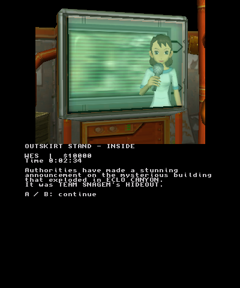
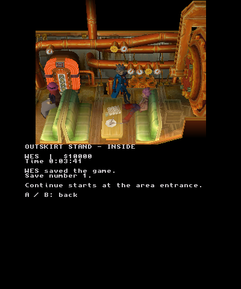
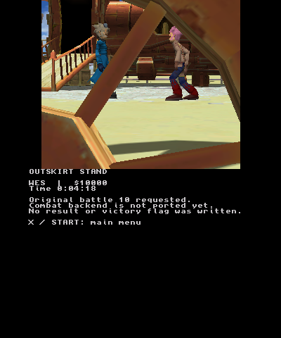

# Native Outskirt Stand first visit

This branch extends the first-area native build with the original exterior and
interior GSVM programs, NPC assets, messages, interaction events, TV scene, and
the original first battle request. It is an incremental port. The battle
backend and later areas are not playable yet.

## Fresh-game acceptance comes first

The opening route is tested from **New Game → WES**, with the original starter
party and initial flags. Continue tests use a save actually created by that
fresh game. The owner's completed save is retained unchanged for later-area
testing only after the fresh route into Outskirt Stand is confirmed. It is not
an opening-route fixture and is not installed by the preparation commands.

There are three distinct kinds of evidence:

- Portable tests execute original script bytes and check state, waits, flags,
  and save roundtrips. Explicit test positioning and door dispatch are fixtures.
- Emulator runs execute the native ARM application with scripted controller
  input and capture its actual combined screens. A script fixture is not a
  substitute for walking through the route in this application.
- Physical acceptance requires the exact combined build on the New 3DS.
  The earlier PR #4 title fix has hardware evidence; it does not establish
  that this larger first-visit build has passed on the console.

## Executed emulator acceptance

The full native ARM build `story-review`, SHA-256
`fe5567d2d60835044d08ae4e335d3d47e95b20cad60914ae501fedadb9f36a63`
(381,732 bytes), completed both controller routes in Azahar on 2026-10-22.
The executable includes the GekkoCTR preview dependency; the first visit uses
the native field/story renderer. See the
[verification record](evidence/native-story-2026-10-22/verification.json),
[fresh trace](evidence/native-story-2026-10-22/fresh-trace.log), and
[Continue trace](evidence/native-story-2026-10-22/continue-trace.log).

| Gate | Observed result |
| --- | --- |
| New Game | Empty primary/backup save folder; selected WES and original starter party |
| Opening | Original 1,926-frame hideout movie timeline completed: 1,795 displayed, 131 skipped by the movie clock |
| Arrival and approach | Bike arrival completed; controller movement triggered original scene 8, both departure messages, boarding and vehicle departure |
| Enter shop | Walked up the ramp and through source door 4; loaded floor 2 |
| TV and dialogue | Original report `426E`; walked down aisle, talked to Willie through `514A`/`514C`; source flag `03DC` set |
| Save | Explicit native confirmation wrote fresh WES save 1 at floor 2 / previous 1 / spawn 0 |
| Continue | New process loaded the same GCI hash; no opening TV-report replay |
| Exit and challenge | Original door 2 returned to floor 1 and executed Willie's challenge |
| Battle boundary | Original `98(10,1,0)` snapshots two player Pokémon and stays pending; no result or victory flag |
| Runtime checks | Fresh run: 21,000 frontend frames. Continue run: 10,000. Both: zero detected guest faults, zero application errors, clean native exit |

The Continue run left the save byte-identical to the freshly written card.
Neither run installed or used the owner's completed save. The separate host
test also destroys and rebuilds the shop scene from its freshly loaded state;
15,595 checks pass normally and under ASan/UBSan.

The recordings contain the actual combined screens, without generated scenes
or a substitute game implementation. They have no audio and use the 60 Hz
emulator frontend clock sampled at 30 fps. They do not measure New 3DS frame
rate. The original window/font system and field audio remain unported.







The next device gate and local-agent instructions are in
[native-story-handoff.md](native-story-handoff.md).

## Hardware stall and renderer ownership

The upstream change in `4cce6c157b065757e9c6512a9ceea51baa96ba1c` writes all
configured texture-coordinate output components in `title_shader.v.pica`.
PR #4 records a working normal title, HOME suspend/resume, and clean exit with
NTR remaining active. See the [physical record](native-first-area-hardware-2026-10-22.md)
and [render recovery](render-recovery.md). This branch preserves that shader
and its compiled-output regression.

This branch also retains the shader program and Citro3D context across scene
changes, drains queued GPU work before freeing scene storage, and adds passive
completion counters. These ownership changes address a separate transition
risk. They do not replace the hardware shader correction.

`platform_memory` trace lines record the actual process heap, linear heap,
and remaining linear bytes at boot, after loading each area, and on scene
failure. The shop needs more than 32 MiB of CPU model storage. A restricted
64 MiB launch with libctru's default 32 MiB linear reservation can therefore
be insufficient; modern Rosalina's actual New 3DS grant must be checked from
the trace before changing allocation policy.

## Prepare the complete private first-area bundle

Keep the existing boot movies, title/menu packs, original opening movie, and
new-game state pack prepared with the instructions in [native boot](native-boot.md).
Use the admitted GC6E01 revision 0 disc and pinned parser, then prepare into
new private directories:

```sh
python3 tools/prepare_outskirt.py --disc /private/disc --output /private/exterior
python3 tools/prepare_area.py --disc /private/disc --output /private/area
python3 tools/prepare_story.py --disc /private/disc --output /private/story
python3 tools/prepare_area_runtime.py \
  --metadata /private/area/area-actors.json \
  --links /private/story/area-events.json \
  --lifecycle /private/story/area-lifecycle.json \
  --names /private/story/actor-names.json \
  --output /private/area-runtime
python3 tools/prepare_battle.py --disc /private/disc --output /private/willie.c3b
```

Stage the generated `.c3t`, `.c3f`, `.c3a`, `.c3c`, `.c3l`, and `.c3s` files
plus `willie.c3b` into the existing private `3ds/Colosseum3DS/boot` folder.
Keep filenames intact: the shop story bank is `outskirt_shop.c3s`. Preserve
the preparation manifests beside the local deployment evidence. No original
game packs, disc files, or saves are committed to the repository.

Wes now requires four prepared clips. The first three retain source clips
1/2/3 for idle/walk/run; the fourth is the genuine source clip 0 used by the
exterior story. Old three-clip packs cannot execute that event. Exterior
actors 0 and 1 also have real assets because the source program reveals them
during the first approach to the stand. Installing only a new executable
over an older asset bundle is insufficient.

The original script and metadata contracts are documented in
[native-story-vm.md](native-story-vm.md), graphics in
[outskirt-interior-assets.md](outskirt-interior-assets.md), and the battle
boundary in [first-battle-adapter.md](first-battle-adapter.md).

## Required controller route

1. Start without installing the completed save. Select New Game and WES;
   watch the original hideout movie and bike arrival.
2. Move around the parked vehicle and approach the front entrance. Execute
   the original two-person departure scene; do not skip its rectangle trigger
   by teleporting directly to the doorway.
3. Enter the shop through the original door, finish the TV report and its
   camera sequence, and regain control.
4. Walk to Willie, talk through his original message and yes/no choice,
   and finish his subsequent message.
5. Save explicitly at the shop checkpoint. Relaunch and Continue that newly
   created WES save, checking the party and original first-visit flags.
6. Leave through the original exit and run the exterior challenge. The build
   must stop honestly at the original encounter-10 battle request.

At the combat boundary the GSVM call remains pending, and the current party
is copied into the battle request. It does not invent victory, damage, rewards,
or flag `03DE`. Defeating Willie requires a real combat backend.

## Remaining port work

The original window/font renderer, field music and sound output, procedural
head aiming, complete people/camera behavior outside this admitted route,
battle execution and presentation, and later areas remain separate work.
The bounded native adapters reject unsupported engine behavior instead of
silently advancing the story. A successful frame budget, visible model, or
saved file is insufficient evidence of whole-game completion.
